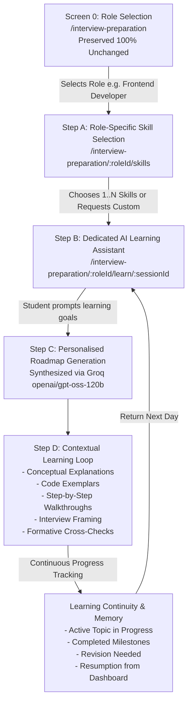
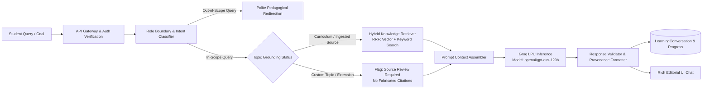
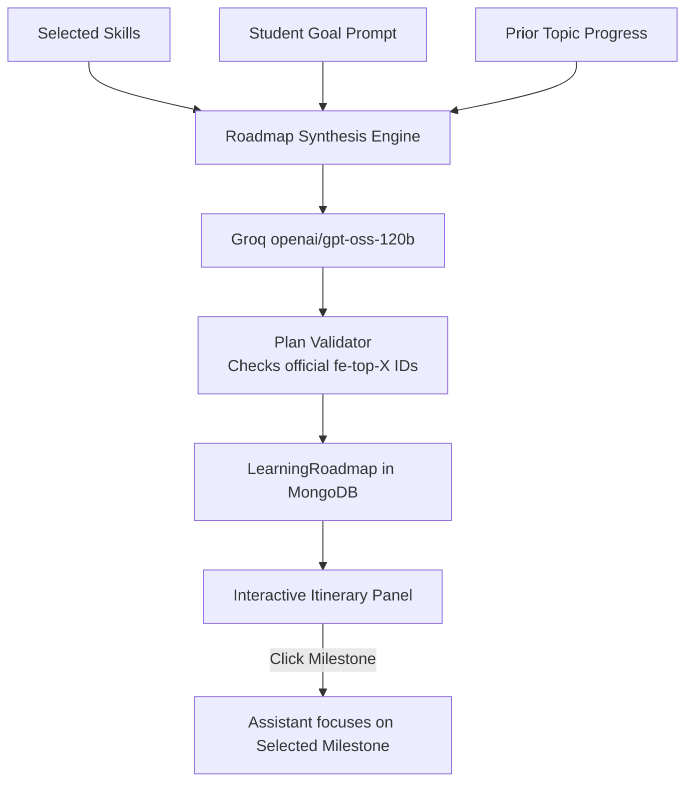
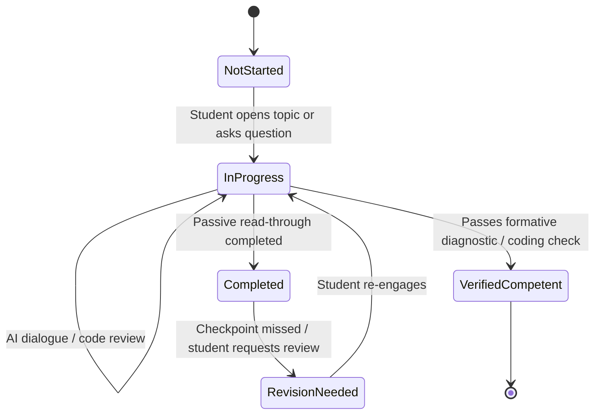
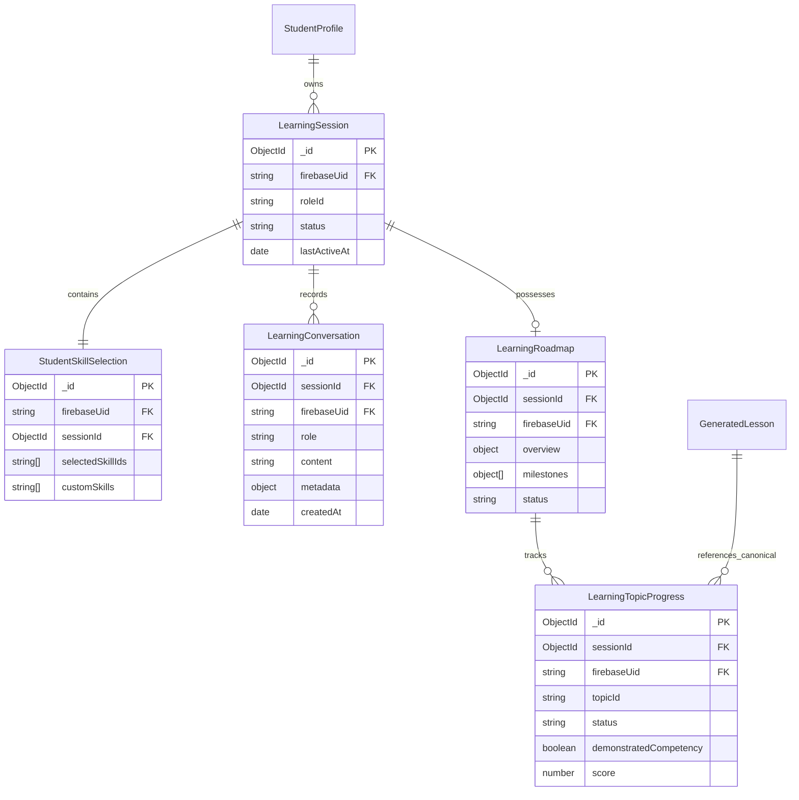
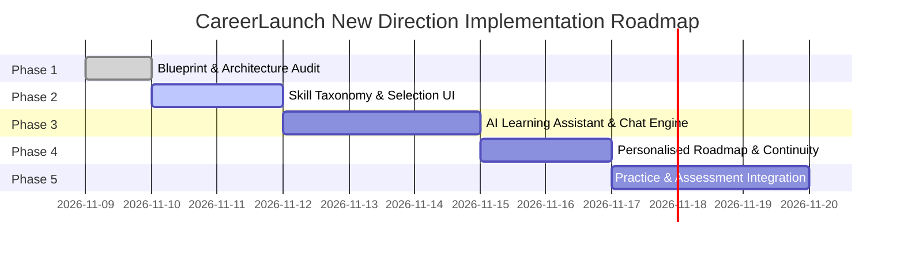

# CareerLaunch — New Product Direction: Phase 1
# Role-Based AI Learning Platform — Architecture & Migration Blueprint

> **Phase**: Phase 1 (Architecture & Migration Blueprint)  
> **Status**: APPROVED BLUEPRINT (PLANNING ONLY — NO APPLICATION CODE MODIFIED)  
> **Document Purpose**: Authoritative architectural blueprint for CareerLaunch's evolution into a role-based, AI-powered interview preparation and continuous learning platform.  
> **Implementation Pilot Role**: Frontend Developer (`frontend-developer`)  
> **LLM Engine**: Groq LPU Inference (`openai/gpt-oss-120b`)  
> **Backend Baseline**: MongoDB `careerlaunch` on port 27018, Node.js/Express, Firebase Auth  
> **Commit Hash**: `b9ef755`  

---

## 1. Product Vision & Philosophy

CareerLaunch is evolving from a static career roadmap and standalone lesson repository into a **simple, role-based, AI-powered interview preparation and continuous learning platform**.

### 1.1 The Core Problem
Traditional placement preparation platforms suffer from two extremes:
1. **Static Roadmaps & Textbooks**: Rigid, unpersonalized curriculum trees where students are overwhelmed by hundreds of checkboxes without guidance on what matters for *their* specific timeline, background, or target companies.
2. **Generic Unbounded Chatbots**: Open-ended conversational assistants that lack role discipline, hallucinate syllabus coverage, invent citations, lose context across sessions, and fail to separate passive browsing from verified technical competence.

### 1.2 The CareerLaunch Solution
CareerLaunch bridges this divide through a role-first, distraction-free learning environment:
- **Role-Anchored Scoping**: The student selects a specific career role (e.g. Frontend Developer). The platform immediately limits its scope to that discipline.
- **Skill-Driven Selection**: Students browse organized, role-specific technical skills (e.g. React, Next.js, CSS Layouts, State Management), choose what they need to master, and define their goals in plain English.
- **Dedicated Conversational Assistant**: A focused AI tutor that provides multi-turn technical explanations, step-by-step code exemplars, and interview-specific advice within the boundaries of the chosen role.
- **Personalised Roadmap**: An interactive, dynamic curriculum itinerary created on demand, grounded in official syllabus standards and verified open-access documentation.
- **Continuous Learning Memory**: The platform remembers conversation history, generated roadmaps, active topics, topics needing revision, and recommended next steps across sessions.

---

## 2. Complete Student Journey

The streamlined student journey eliminates cognitive overhead and multi-step onboarding hurdles:

$$\text{Select Role} \longrightarrow \text{Select Skills} \longrightarrow \text{Open AI Assistant} \longrightarrow \text{Generate Roadmap} \longrightarrow \text{Contextual Learning} \longrightarrow \text{Resume Anytime}$$



### Detailed Journey Steps:
1. **Role Selection (`/interview-preparation`)**: The student views CareerLaunch's approved 8-card role catalog (Frontend, Backend, Full Stack, Software Engineer, Data Analyst, Data Scientist, DevOps, Mobile). The interface is 100% visually and functionally preserved.
2. **Skill Selection (`/interview-preparation/:roleId/skills`)**: The student views a clean, organized inventory of core technologies and concepts relevant to that role. They can filter via search, select one or multiple skills, or add a custom skill.
3. **Dedicated Learning Assistant (`/interview-preparation/:roleId/learn/:sessionId`)**: A distraction-free workspace opens. The student describes what they want to prepare (e.g., *"Preparing for campus interviews, know basic JS and React, need help with hooks cleanup and state management"*).
4. **Personalised Roadmap**: The AI synthesizes a tailored topic roadmap displayed in a collapsible side itinerary.
5. **Contextual AI Learning**: The student engages in focused, multi-turn technical dialogue. The assistant explains concepts, presents production-grade code examples, poses checkpoint questions, and frames discussions around real placement interview expectations.
6. **Learning Continuity**: When returning to CareerLaunch, the student is greeted with a single-click resumption widget: *"Continue Frontend Learning: React Hooks (Topic 3 of 6)"*, picking up exactly where they stopped with complete conversation and roadmap state intact.

---

## 3. Frontend Developer Skill Taxonomy (Pilot Track)

For the Frontend Developer pilot role, skills are categorized into 12 core domains. Every skill maps to its curriculum alignment, proficiency tier, interview weighting, and knowledge source status.

| Category | Skill / Technology | Official Curriculum Mapping | Proficiency Tiers | Placement Interview Relevance | Knowledge Source Status |
|---|---|---|---|---|---|
| **1. HTML & Accessibility** | Semantic HTML5 & Landmark Outlines | `fe-top-1` | Beginner $\to$ Advanced | High (Form semantics, SEO, Accessibility screening) | Verified (`whatwg-standards`) |
| | WCAG 2.1 & Keyboard Navigation | `fe-top-13` | Intermediate $\to$ Advanced | High (ARIA attributes, Focus trapping, Screen readers) | Syllabus Topic (MDN / W3C mapped) |
| **2. CSS & Responsive Design** | Box Model, Flexbox & CSS Grid | `fe-top-2` | Beginner $\to$ Advanced | Very High (Layout mechanics, centering, responsive alignments) | Verified (`w3c-standards`) |
| | Responsive Design & Media Queries | `fe-top-3` | Beginner $\to$ Intermediate | High (Fluid typography, clamp(), viewport units, mobile breakpoints) | Verified (`w3c-standards`) |
| | Modern CSS: Variables, Subgrid & CSS Modules | Curriculum Extension | Intermediate $\to$ Advanced | Medium (Scoped styles, design tokens, maintainable theming) | Syllabus Topic |
| **3. JavaScript Fundamentals** | Execution Context, Scope & Closures | `fe-top-4` | Beginner $\to$ Advanced | Critical (Lexical scope, hoisting, memory retention, TDZ) | Verified (`ecma-standards`) |
| | Asynchronous JS & Browser Event Loop | `fe-top-6` | Intermediate $\to$ Advanced | Critical (Microtasks vs macrotasks, Promises, async/await) | Syllabus Topic (HTML spec mapped) |
| | DOM Architecture & Event Delegation | `fe-top-5` | Beginner $\to$ Intermediate | High (Event bubbling, capturing, target vs currentTarget) | Syllabus Topic (WHATWG DOM mapped) |
| **4. TypeScript** | Static Typing & Type Annotations | Custom / Extension | Beginner $\to$ Intermediate | Very High (Primitives, unions, type inference, interfaces) | Source Review Required |
| | Advanced Generics & Utility Types | Custom / Extension | Intermediate $\to$ Advanced | High (Record, Partial, Pick, Omit, conditional types) | Source Review Required |
| **5. React Fundamentals** | JSX, Virtual DOM & Reconciliation | `fe-top-7` | Beginner $\to$ Intermediate | Critical (Diffing algorithm, element keys, component lifecycle) | Syllabus Topic (React docs mapped) |
| | Component Architecture & Props | `fe-top-7` | Beginner $\to$ Intermediate | Critical (Pure components, container/presenter, composition) | Syllabus Topic (React docs mapped) |
| **6. Modern React Hooks** | State & Effect Hooks (`useState`, `useEffect`) | `fe-top-8`, `fe-top-9` | Beginner $\to$ Intermediate | Critical (Dependency arrays, stale closures, effect cleanup) | Syllabus Topic (React docs mapped) |
| | Performance & Ref Hooks (`useMemo`, `useCallback`, `useRef`) | `fe-top-9` | Intermediate $\to$ Advanced | Critical (Referential equality, DOM refs, expensive recomputations) | Syllabus Topic (React docs mapped) |
| | Custom Hook Extraction | `fe-top-9` | Intermediate $\to$ Advanced | Very High (Reusable logic, headless state abstraction) | Syllabus Topic (React docs mapped) |
| **7. Next.js & Modern Frameworks** | Next.js App Router & Server Components (RSC) | Custom / Extension | Intermediate $\to$ Advanced | Very High (Client vs server components, streaming SSR, layouts) | Source Review Required |
| | Routing, Server Actions & Data Fetching | Custom / Extension | Intermediate $\to$ Advanced | High (Server Actions, revalidation, route handlers) | Source Review Required |
| **8. State Management** | React Context API & Unidirectional Flow | `fe-top-10` | Beginner $\to$ Intermediate | High (Prop drilling solutions, context re-render pitfalls) | Syllabus Topic |
| | Global Stores: Redux Toolkit (RTK) | `fe-top-11` | Intermediate $\to$ Advanced | High (Redux slices, immutability, selectors, middleware) | Source Review Required |
| | Server State: TanStack Query (React Query) | `fe-top-12` | Intermediate $\to$ Advanced | Very High (Query caching, deduplication, invalidation, mutations) | Source Review Required |
| **9. API Integration & Network** | Fetch API, Axios & REST Client Contracts | `fe-top-12` | Beginner $\to$ Intermediate | Very High (HTTP status codes, abort controllers, retry logic) | Syllabus Topic |
| | WebSockets & Real-time Client Streams | Curriculum Extension | Intermediate $\to$ Advanced | Medium (Socket events, reconnect strategies, heartbeat) | Syllabus Topic |
| **10. Browser Fundamentals** | Client Storage: localStorage, sessionStorage, Cookies | Curriculum Extension | Beginner $\to$ Intermediate | High (Storage limits, security flags: HttpOnly, Secure, SameSite) | Syllabus Topic |
| | Web Security: CORS, XSS, CSRF | Curriculum Extension | Intermediate $\to$ Advanced | Critical (Origin matching, input sanitization, token defense) | Syllabus Topic |
| **11. Web Performance** | Core Web Vitals (LCP, INP, CLS) | `fe-top-14` | Intermediate $\to$ Advanced | Very High (Diagnostic profiling, layout shifts, interaction speed) | Syllabus Topic (W3C WebPerf mapped) |
| | Rendering Pipeline: Reflow & Repaint | `fe-top-15` | Intermediate $\to$ Advanced | High (Compositor thread, transform vs top/left, GPU acceleration) | Syllabus Topic |
| | Code Splitting & Dynamic Imports | `fe-top-17` | Intermediate $\to$ Advanced | High (React.lazy, Suspense, bundle analysis, tree shaking) | Syllabus Topic |
| **12. Testing & Tooling** | Unit & Component Testing (Vitest / RTL) | `fe-top-16` | Intermediate $\to$ Advanced | High (User-centric tests, mocking APIs via MSW, test assertions) | Syllabus Topic |
| | Git & GitHub Version Control | Curriculum Extension | Beginner $\to$ Intermediate | Critical (Branching strategies, merge conflicts, pull requests) | Syllabus Topic |

---

## 4. Proposed Skill Taxonomies for All Eight Roles

While Frontend Developer is the primary implementation pilot, the platform's role-to-skill taxonomy is designed to support all 8 existing roles uniformly:

```
├── 1. Frontend Developer (UI Engineering, React, Next.js, CSS, Browser Internals, Web Vitals)
├── 2. Backend Developer (Node.js/Express, Python/FastAPI, SQL & NoSQL, Redis, Message Queues, Microservices)
├── 3. Full Stack Developer (MERN/Next.js Full-Stack, Auth Pipelines, Schema Design, REST/GraphQL, Cloud Deploy)
├── 4. Software Engineer (Data Structures, Algorithms, Dynamic Programming, System Design, Operating Systems, Networks)
├── 5. Data Analyst (Advanced SQL, Python Pandas/NumPy, Tableau/PowerBI, EDA, Statistics, Cohort Metrics)
├── 6. Data Scientist (Probability, Supervised/Unsupervised ML, Deep Learning, Feature Engineering, MLOps, Model Metrics)
├── 7. DevOps Engineer (Linux Internals, Docker, Kubernetes, CI/CD Actions, Terraform IaC, AWS/GCP, Prometheus/Grafana)
└── 8. Mobile App Developer (React Native, Flutter, Native Android/iOS, Mobile Lifecycle, Offline Sync, Native Modules)
```

### 4.1 Backend Developer
1. **Language Runtimes**: Node.js (Async I/O, Streams, Worker Threads) / Python (FastAPI, Django, ASGI/WSGI) / Java (JVM, Spring Boot).
2. **Relational Databases & SQL**: PostgreSQL, MySQL, Indexing (B-Tree, Hash), Query Planning (`EXPLAIN ANALYZE`), ACID transactions, Normalization.
3. **NoSQL & Document Stores**: MongoDB, DynamoDB, Sharding, Replica Sets, Document modeling.
4. **API Architecture**: RESTful design principles, GraphQL schemas & resolvers, gRPC & Protocol Buffers.
5. **In-Memory Caching**: Redis (Cache-aside, Write-through, Eviction policies, Redis data structures).
6. **Message Brokers & Async Tasks**: RabbitMQ, Apache Kafka, BullMQ, Idempotent event consumers, Dead-letter queues.
7. **Concurrency & Threading**: Process models, Race conditions, Distributed locks (Redlock), Thread pools.
8. **Authentication & Security**: OAuth 2.0 / OIDC, JWT signing & revocation, Rate limiting, SQL injection defense.
9. **System Architecture**: Monolith to Microservices, Database per service, Saga pattern, API Gateways.
10. **Backend Testing**: Unit testing, Integration testing with Testcontainers, API Contract testing.

### 4.2 Full Stack Developer
1. **Frontend Core**: Semantic HTML, Modern CSS, Responsive Design, JavaScript ESNext.
2. **Component Libraries & Frameworks**: React, Next.js (Full-stack App Router), TypeScript across the stack.
3. **Backend Services & APIs**: Express.js / Fastify / Next.js Route Handlers, REST API conventions.
4. **Database Design & ORMs**: Prisma, Mongoose, Drizzle ORM, Schema migrations, Connection pooling.
5. **Authentication & Sessions**: NextAuth/Auth.js, JWT, HTTP-only cookie session handling, Role-Based Access Control (RBAC).
6. **Client-Server Integration**: Data contracts, tRPC, TanStack Query integration, Optimistic UI updates.
7. **Cloud Hosting & Deployment**: Vercel, Render, Railway, Docker multi-stage builds, Environment configuration.
8. **Security & State Sanitation**: CSRF protection, Content Security Policy (CSP), Input validation with Zod.

### 4.3 Software Engineer (Core CS & Problem Solving)
1. **Linear Data Structures**: Arrays, Two-Pointer mechanics, Linked Lists (Singly/Doubly/Circular), Stacks, Queues, Monotonic Variants.
2. **Non-Linear Data Structures**: Binary Trees, BSTs, AVL/Red-Black Tree invariants, Heaps & Priority Queues, Tries, Graphs.
3. **Core Algorithmic Paradigms**: Binary Search & Interval Bisection, Sorting (Quick, Merge, Heap), BFS & DFS Traversals, Topological Sort, Dijkstra's Shortest Path.
4. **Advanced Problem Solving**: Recursion & Backtracking, Dynamic Programming (1D/2D, Memoization vs Tabulation), Greedy algorithms, Bit manipulation.
5. **Complexity Analysis**: Big-O, Big-$\Omega$, Big-$\Theta$, Amortized analysis, Master Theorem.
6. **Operating Systems**: Processes vs Threads, CPU Scheduling, Synchronization primitives (Mutex, Semaphore), Virtual Memory, Paging, Deadlocks.
7. **Computer Networks**: OSI Model, TCP vs UDP, TCP 3-Way Handshake, HTTP/1.1 vs HTTP/2 vs HTTP/3, TLS/SSL, DNS.
8. **Software Design & Patterns**: SOLID principles, Object-Oriented Design, Gang of Four patterns (Factory, Singleton, Observer, Strategy, Decorator).
9. **High-Level System Design**: Scalability fundamentals, Load balancers, Consistent hashing, Database partitioning, CAP theorem.

### 4.4 Data Analyst
1. **Advanced SQL**: Window functions (`ROW_NUMBER`, `RANK`, `LEAD`, `LAG`), CTEs, Self-joins, Aggregate subqueries, PIVOT.
2. **Data Manipulation in Python/R**: Pandas dataframes, NumPy vectorization, Missing data imputation, Data type casting.
3. **Exploratory Data Analysis (EDA)**: Distribution analysis, Outlier detection, Correlation matrices, Skewness correction.
4. **Business Intelligence & Dashboards**: Tableau / Power BI, DAX formulas, Interactive drill-downs, Executive KPI cards.
5. **Business & Product Metrics**: Customer Lifetime Value (CLV), Churn rate, Cohort retention curves, Conversion funnels, CAC.
6. **Applied Statistics**: Descriptive statistics, Normal distribution, Z-scores, Confidence intervals, A/B test hypothesis testing ($p$-values).
7. **Data Storytelling & Reporting**: Executive summarization, Choosing appropriate visualizations, Automated report generation.

### 4.5 Data Scientist
1. **Mathematical Foundations**: Linear Algebra (Vectors, Matrices, Eigenvalues), Multivariable Calculus (Gradients), Probability distributions.
2. **Statistical Inference**: Maximum Likelihood Estimation (MLE), Hypothesis testing (t-test, ANOVA, Chi-Square), Bayesian inference.
3. **Supervised Machine Learning**: Linear/Logistic Regression, Decision Trees, Random Forests, Gradient Boosted Trees (XGBoost, LightGBM), SVMs.
4. **Unsupervised Learning**: K-Means clustering, Hierarchical clustering, PCA dimensionality reduction, t-SNE.
5. **Feature Engineering**: Target encoding, One-hot encoding, Feature scaling, Interaction terms, Handling imbalanced data (SMOTE).
6. **Model Evaluation & Loss Functions**: ROC-AUC, Precision-Recall curves, F1-Score, Cross-Validation, Log-loss, MSE/MAE.
7. **Deep Learning Fundamentals**: Neural networks, Backpropagation, Activation functions, Regularization (Dropout, Weight Decay), PyTorch basics.
8. **MLOps & Deployment**: Model serialization (ONNX, Pickle), Flask/FastAPI model inference, Experiment tracking (MLflow).

### 4.6 DevOps Engineer
1. **Linux Operating Systems & Shell**: Bash scripting, Linux directory hierarchy, Process management (`systemd`, `ps`, `top`), Permissions, SSH keys.
2. **Containerization**: Docker architecture, Writing efficient Dockerfiles, Multi-stage builds, Docker Compose orchestration.
3. **Container Orchestration**: Kubernetes core objects (Pods, Deployments, Services, ConfigMaps, Secrets), Namespaces, Ingress controllers.
4. **CI/CD Automation**: GitHub Actions workflows, Pipeline triggers, Automated linting/testing, Artifact deployment, Secret management.
5. **Infrastructure as Code (IaC)**: Terraform (HCL, State files, Providers, Modules), Ansible playbooks.
6. **Cloud Infrastructure (AWS/GCP)**: VPC networking, Subnets, Security Groups, IAM roles & policies, Compute (EC2/ECS), Storage (S3).
7. **Observability & Reliability**: Prometheus metrics collection, Grafana dashboards, Centralized logging (Loki / ELK), SRE concepts (SLO, SLA, SLI).
8. **Networking & Security**: Reverse proxies (Nginx, Caddy), TLS certificate automation (Let's Encrypt), VPNs, Firewalls.

### 4.7 Mobile App Developer
1. **Core Cross-Platform Platforms**: React Native / Flutter / Native Android (Kotlin) / Native iOS (Swift).
2. **Mobile Layouts & UI**: Adaptive layouts, Safe Area insets, Flexbox in React Native, Touch gestures, Native animations.
3. **Application Lifecycle**: Active, Inactive, Background, Suspended states; Memory warning handling; Deep linking.
4. **Offline Persistence & Caching**: SQLite, Realm, WatermelonDB, Async Storage, Cache synchronization.
5. **Device Hardware APIs**: Camera, Geolocation, Accelerometer, Push Notifications (APNs, FCM), Biometric authentication.
6. **Networking & Resilience**: Offline-first architecture, Network status detection, Exponential backoff on dropped connections.
7. **Store Deployment & CI/CD**: Fastlane automation, App Store Connect guidelines, Google Play Console release tracks, Code signing.
8. **Mobile Performance**: Frame rate optimization (60/120 FPS), Image caching & downsampling, Bundle size reduction, Profiling memory leaks.

---

## 5. AI Learning Assistant Architecture

The AI learning assistant provides a natural, contextual dialogue while adhering to strict pedagogical principles and role boundaries:



### 5.1 System Prompt Design
The assistant's system prompt enforces:
1. **Role Persona**: Senior Technical Mentor for the specific target role (e.g. Principal Frontend Architect).
2. **Pedagogical Structure**:
   - Begin with an intuitive conceptual definition without dense jargon.
   - Provide concrete, production-grade code exemplars clearly attributed to CareerLaunch Engineering.
   - Explain real-world placement interview angles: *"Why interviewers ask this"*, *"Common candidate pitfalls"*, *"Edge cases to bring up"*.
   - Conclude with a targeted, thought-provoking checkpoint question to test active comprehension rather than passive reading.
3. **License & Provenance Integrity**:
   - Only cite approved, ingested knowledge sources (WHATWG, W3C, ECMA, NIST).
   - If discussing a topic without ingested sources (e.g. Next.js, Redux Toolkit), explain it authoritatively based on verified engineering practice, clearly labeling it as CareerLaunch-authored without fabricating academic citations.
4. **Tone**: Warm, encouraging, concise, rigorous, and completely free of filler or generic marketing prose.

### 5.2 Conversational State & Context Window Management
- Each session maintains a sliding context window of recent dialogue exchanges (the last 6–8 turns) combined with a summarized memory block of earlier topics covered in the session.
- Total context length is strictly tracked using token budgeting to remain comfortably within the 128k context window of `openai/gpt-oss-120b`.

---

## 6. Personalised Roadmap Architecture

When a student selects their target skills and describes their preparation goal, the system synthesizes a personalized roadmap:



### 6.1 Roadmap Structure
Every generated milestone contains:
- `milestoneId`: Unique identifier (e.g., `m-1`, `m-2`).
- `title`: Actionable technical milestone title.
- `officialTopicId`: Maps to canonical curriculum ID (e.g., `fe-top-1` to `fe-top-17`) when covering official curriculum topics.
- `topicSource`: `'curriculum'` or `'student_custom'`.
- `difficulty`: `'beginner'`, `'intermediate'`, or `'advanced'`.
- `priority`: `'high'`, `'medium'`, or `'low'`.
- `reasonForRecommendation`: Explains how the milestone addresses the student's background and declared goal.
- `learningObjectives`: Specific outcomes the student will master.
- `estimatedMinutes`: Realistic study duration.
- `knowledgeSupportStatus`: `'verified'` (ingested source), `'roadmap_topic'` (official syllabus), or `'source_review_required'` (custom extension).
- `status`: `'not_started'`, `'in_progress'`, `'completed'`, or `'revision_needed'`.

---

## 7. Role-Based AI Boundaries & Scope Enforcement

A key requirement of the new architecture is **strict backend-enforced role and skill scope**.

### 7.1 The Contextual Boundary Principle
Role enforcement must **not** rely on a naive keyword blacklist. In modern engineering, technologies frequently intersect:
- *Acceptable Intersection*: A Frontend Developer student asking how Next.js Server Components interact with a backend REST API or how Node.js streams render HTML is completely valid within frontend architecture.
- *Out-of-Scope Deviation*: That same student asking how to write an Ansible playbook for database replication, train a Convolutional Neural Network in PyTorch, or calculate financial options volatility is out of scope.

### 7.2 The Intent Classifier Pipeline
Every incoming message passes through a lightweight classifier before invocation:
1. **Context Extraction**: Inspects the student's active role (`frontend-developer`) and chosen skills.
2. **Domain Relevance Evaluation**: Evaluates whether the primary intent relates to the chosen role or valid cross-boundary engineering topics.
3. **Response Strategy**:
   - **In-Scope**: Handled directly by the assistant with full technical rigor.
   - **Cross-Boundary with Frontend Relevance**: Answered through the lens of the student's role (e.g. explaining backend status codes specifically from the perspective of client error handling and user feedback).
   - **Completely Out-of-Scope**: Politely redirected using a warm pedagogical bridge:
     > *"That is an interesting topic in DevOps infrastructure, but our current focus is your Frontend Developer preparation track. Let's keep our energy focused on mastering React Hooks and state management for your upcoming interviews. If you'd like to explore cloud deployment later, you can switch to the DevOps Engineer track from the role selection catalog."*

### 7.3 Knowledge Provenance Classification
The assistant categorizes every technical claim into one of three tiers:
1. **Tier 1 — Grounded in Verified Open-Access Evidence**: Sourced from ingested NIST, W3C, WHATWG, or ECMA documentation. Fully verified with document-level provenance.
2. **Tier 2 — Curriculum-Syllabus Standard**: Official CareerLaunch curriculum topics without ingested full-text vectors. Attributed to CareerLaunch Technical Curriculum.
3. **Tier 3 — Custom Industry Extension (Source Review Required)**: Topics like Next.js or Redux Toolkit where no official public domain source is currently ingested. The assistant answers authoritatively using vetted industry standards while flagging that official source review is ongoing. **Zero fake citations are ever generated.**

---

## 8. Learning History, Progress & Competency

CareerLaunch remembers where a student stopped and distinguishes between **passive exposure** and **demonstrated understanding**.

### 8.1 Passive Exposure vs. Demonstrated Competency
- **Passive Exposure**: A student reads a lesson, browses an explanation, or scrolls through code snippets. This updates the topic status to `in_progress` and logs time spent, but does *not* award verified competency badges.
- **Demonstrated Competency**: The student actively answers a formative cross-question, writes a correct code implementation, or diagnoses a subtle bug presented by the AI assistant. Demonstrated competency is recorded with a verification timestamp and score.



### 8.2 Learning State Tracking
For every student and active role, CareerLaunch maintains:
- `activeSessionId`: The currently open learning dialogue.
- `selectedSkills`: The list of technologies the student selected for this cycle.
- `activeTopicId`: The topic currently being discussed.
- `completedTopicIds`: Milestones where foundational review is complete.
- `verifiedTopicIds`: Milestones where active technical competency was demonstrated.
- `revisionTopicIds`: Milestones flagged for reinforcement.
- `recommendedNextTopic`: The next logical topic derived from prerequisites.

---

## 9. Proposed Database Design

The database schema is streamlined to minimize unnecessary collection proliferation while enforcing strict data ownership and separating public educational content from private student sessions.



### 9.1 Model Specifications

#### 1. `StudentSkillSelection`
- `firebaseUid`: String (indexed)
- `sessionId`: ObjectId ref `LearningSession` (indexed)
- `roleId`: String (enum of 8 roles)
- `selectedSkills`: `[{ skillId: String, name: String, category: String }]`
- `customSkills`: `[{ name: String, requestedAt: Date }]`
- `timestamps`: true

#### 2. `LearningSession`
- `firebaseUid`: String (indexed)
- `roleId`: String (indexed)
- `title`: String (e.g. *"Frontend Campus Placement Prep"*)
- `status`: String (`'active'`, `'paused'`, `'completed'`)
- `currentTopicId`: String (optional)
- `lastActiveAt`: Date (indexed for rapid dashboard resumption)
- `timestamps`: true

#### 3. `LearningConversation`
- `sessionId`: ObjectId ref `LearningSession` (indexed)
- `firebaseUid`: String (indexed)
- `role`: String (`'user'`, `'assistant'`, `'system'`)
- `content`: String (markdown text)
- `topicId`: String (optional, tags dialogue turn to a specific roadmap milestone)
- `metadata`:
  - `tokens`: `{ prompt: Number, completion: Number, total: Number }`
  - `intent`: `{ isInScope: Boolean, detectedDomain: String, redirected: Boolean }`
  - `sourcesCited`: `[{ sourceId: String, docId: String, chunkId: String }]`
- `createdAt`: Date (indexed)

#### 4. `LearningRoadmap`
- `sessionId`: ObjectId ref `LearningSession` (indexed, unique per session)
- `firebaseUid`: String (indexed)
- `roleId`: String
- `overview`: `{ goalPrompt: String, summary: String, targetTimeline: String }`
- `milestones`: `[{ milestoneId: String, title: String, officialTopicId: String, topicSource: String, difficulty: String, priority: String, estimatedMinutes: Number, orderIndex: Number, status: String }]`
- `status`: String (`'draft'`, `'active'`, `'completed'`)
- `timestamps`: true

#### 5. `LearningTopicProgress`
- `sessionId`: ObjectId ref `LearningSession` (indexed)
- `firebaseUid`: String (indexed)
- `topicId`: String (indexed)
- `status`: String (`'not_started'`, `'in_progress'`, `'completed'`, `'revision_needed'`)
- `demonstratedCompetency`: Boolean (default: `false`)
- `competencyScore`: Number (0–100)
- `timeSpentMinutes`: Number
- `lastInteractedAt`: Date
- `timestamps`: true

---

## 10. API Design

All endpoints require verified Firebase Bearer tokens (`requireAuth`). Ownership is verified via `req.user.uid === resource.firebaseUid`.

### 10.1 Skills & Roles Endpoints
- `GET /api/learning/roles/:roleId/skills`  
  *Returns the structured skill taxonomy for the specified role.*
- `POST /api/learning/skills/select`  
  *Saves or updates the student's selected skills for a learning session.*  
  *Body*: `{ roleId, selectedSkillIds: [...], customSkills: [...] }`

### 10.2 Learning Sessions & Continuity Endpoints
- `POST /api/learning/session/start`  
  *Initializes a new dedicated learning session for a role with chosen skills.*  
  *Body*: `{ roleId, skillSelectionId, goalPrompt }`
- `GET /api/learning/session/:sessionId`  
  *Retrieves session details, active topic, and roadmap status.*
- `GET /api/learning/session/latest?roleId=...`  
  *Retrieves the student's most recently active session for quick one-click resumption.*
- `GET /api/learning/dashboard/resume`  
  *Returns the student's active learning cards across roles for the main dashboard.*

### 10.3 Conversational AI Assistant Endpoints
- `POST /api/learning/session/:sessionId/message`  
  *Sends a user message to the dedicated AI tutor. Evaluates role scope, retrieves knowledge chunks when applicable, queries Groq `openai/gpt-oss-120b`, and returns the assistant response with formative checkpoint recommendations.*  
  *Body*: `{ message, currentTopicId }`
- `GET /api/learning/session/:sessionId/messages?limit=50&before=...`  
  *Retrieves paginated conversation history for the session.*

### 10.4 Roadmap & Progress Endpoints
- `POST /api/learning/session/:sessionId/roadmap/generate`  
  *Synthesizes a personalized learning roadmap based on selected skills and goal prompt.*
- `GET /api/learning/session/:sessionId/roadmap`  
  *Retrieves the current roadmap with real-time milestone progress states.*
- `PUT /api/learning/session/:sessionId/progress/topic/:topicId`  
  *Updates topic status (e.g., mark as completed, flag for revision).*  
  *Body*: `{ status, timeSpentMinutes }`

---

## 11. Existing System Audit & Migration Matrix

Every existing component, route, model, and service in the CareerLaunch repository has been inspected and classified:

| Existing Asset / Component | Path | Current Purpose | Classification | Migration Strategy |
|---|---|---|---|---|
| **Role Selection Catalog Page** | `src/pages/InterviewPreparationPage.jsx` | 8-card role selection grid (`/interview-preparation`) | **1. Reuse Unchanged** | **Preserve 100% untouched**. Update role click handler for Frontend Developer to route to new Skill Selection page. |
| **Role Metadata Registry** | `src/data/interviewRoles.js` | Authoritative definition of 8 career roles | **1. Reuse Unchanged** | Preserved exactly. Add references to new role skill taxonomies. |
| **Authentication System** | `src/lib/firebase.js`, `src/hooks/useAuth.js`, `server/src/middleware/authMiddleware.js` | Firebase token verification & auth state | **1. Reuse Unchanged** | Preserved. All new learning endpoints leverage existing `requireAuth`. |
| **Groq AI Provider Client** | `server/src/services/ai/groqProvider.js`, `aiConfig.js` | High-speed LPU inference with `openai/gpt-oss-120b` | **1. Reuse Unchanged** | Preserved. New learning assistant directly utilizes `GroqProvider`. |
| **Canonical Lesson Inventory (20 Lessons)** | MongoDB `generatedlessons` | 16 Software Engineer + 4 Frontend Developer lessons | **1. Reuse Unchanged** | Preserved intact. Can be linked directly as deep-dive references from chat. |
| **Knowledge Sources & RAG Chunks** | MongoDB `knowledgesources`, `ingesteddocuments`, `contentchunks` | 7 sources, 20 docs, 28 verified content chunks | **1. Reuse Unchanged** | Preserved intact. Sourced by hybrid retriever during learning dialogue. |
| **Hybrid Knowledge Retriever** | `server/src/services/retrieval/hybridRetriever.js` | Vector + keyword RRF search | **1. Reuse Unchanged** | Preserved. Supplies factual evidence chunks to conversation engine. |
| **Curriculum Registry** | `server/src/services/ai/curriculumRegistry.js` | Canonical mapping of `fe-top-1` to `fe-top-17` | **1. Reuse Unchanged** | Preserved. Used to ground roadmap synthesis. |
| **Student Profile Model** | `server/src/models/StudentProfile.js` | Student metadata, education, target roles | **2. Reuse with Modifications** | Keep schema intact; add optional `activeLearningSessionId` reference. |
| **Frontend Topic Lesson View** | `src/components/interview/LessonContentView.jsx` | 9-section editorial lesson rendering | **2. Reuse with Modifications** | Reuse as an optional in-depth reading modal accessible from the learning assistant. |
| **Preparation Setup Page** | `src/pages/PreparationSetupPage.jsx` | Phase B1 intake setup page | **4. Keep Temporarily (Backward Comp.)** | Retain route `/interview-preparation/frontend-developer/setup` so previous student setups remain accessible during Phase 1 & 2. |
| **Preparation Session Model** | `server/src/models/PreparationSession.js` | Stores Phase B1 setup records | **4. Keep Temporarily (Backward Comp.)** | Preserve all existing records in MongoDB. Zero data deletion. |
| **Diagnostic Session Model & Engine** | `server/src/models/DiagnosticSession.js`, `DiagnosticPage.jsx` | Phase B2 adaptive diagnostic | **4. Keep Temporarily (Backward Comp.)** | Retain endpoints and questions. Diagnostic question bank can be repurposed for interactive competency checks. |
| **Preparation Plan Model & Page** | `server/src/models/PreparationPlan.js`, `PreparationPlanPage.jsx` | Phase B2 preparation plan | **4. Keep Temporarily (Backward Comp.)** | Retain existing records. Roadmap schema in new architecture evolves from this model. |
| **Static Roadmap Tree Sidebar** | `src/pages/InterviewPreparationPage.jsx` (roadmap view) | Static 3-level module tree | **5. Defer / Retire After Migration** | Transition to dynamic personalized roadmap sidebar in the new assistant workspace after user sign-off. |

---

## 12. UI Screen Specifications

The new interface embraces CareerLaunch's editorial design system (Warm Ivory, Deep Forest, Muted Terracotta, Soft Sage) while delivering a clean, modern, distraction-free environment.

### 12.1 Screen 0 — Target Role Selection (`/interview-preparation`)
- **Status**: **PRESERVED 100% UNCHANGED**.
- Preserves header, subtitle, 8 role cards, Lucide icons, descriptions, stage badges, and responsive grid.
- Selecting **Frontend Developer** navigates to the new Skill Selection view (`/interview-preparation/frontend-developer/skills`).

### 12.2 Screen 1 — Role-Specific Skill Selection (`/interview-preparation/:roleId/skills`)
- **Header**: Breadcrumbs (`Interview Prep / Frontend Developer / Skill Selection`), Title (*"What technologies do you want to master?"*), Subtitle.
- **Search Bar**: Instant filtering across skill names, categories, and keywords.
- **Categorized Skill Grid**: Clean cards grouped by category (HTML/CSS, JavaScript, Frameworks, State Management, Tooling). Each card shows skill name, description, priority badge, and an interactive toggle checkbox.
- **Custom Skill Prompt**: Inline field at the bottom: *"Need something else? Add custom skill (e.g. Astro, WebGPU, GraphQL)"*.
- **Selected Skills Tray**: Sticky bottom bar displaying count of selected skills with removable pills and primary button: **"Open Learning Assistant"** $\to$.

### 12.3 Screen 2 — Dedicated AI Learning Assistant & Chat (`/interview-preparation/:roleId/learn/:sessionId`)
- **Layout**: Two-column layout (collapsible roadmap on left, conversational workspace on right).
- **Left Column (Roadmap Drawer, 320px)**:
  - Overall progress bar (e.g. *"Topic 2 of 5 in progress"*).
  - Vertical milestone list with status indicators (`not_started`, `in_progress`, `completed`).
  - Clicking any milestone immediately reorients the conversational assistant to that topic.
- **Right Column (Conversational Stage, flexible max 840px)**:
  - Clean message thread: user bubbles in Warm Ivory/Sand, assistant responses in clear typography with typography tokens.
  - Markdown formatting: highlighted code blocks with language badges, bulleted concept breakdowns, and interview callout cards.
  - Interactive Action Chips: *"Explain with code example"*, *"Ask me a placement interview question"*, *"Show common bugs"*.
  - Message Input Bar: Clean textarea with auto-resize, send button, and keyboard shortcut (`Enter` to send, `Shift+Enter` for newline).

### 12.4 Screen 3 — Dashboard Resumption Widget (`/dashboard`)
- A prominent, clean resumption card at the top of the student dashboard:
  - Role badge: **Frontend Developer**.
  - Current milestone: **React Hooks: Dependency Arrays & Cleanup**.
  - Quick stats: 3 of 6 topics completed (50%).
  - Primary button: **"Resume Learning Session"** $\to$.

---

## 13. Implementation Phases & Acceptance Criteria



### Phase 1 — Architecture & Migration Blueprint (Current Phase)
- **Deliverable**: `docs/CAREERLAUNCH_NEW_PRODUCT_ARCHITECTURE_BLUEPRINT.md`.
- **Constraint**: Planning only. Zero code modifications. Baseline invariants strictly verified.

### Phase 2 — Skill Taxonomy & Selection Experience
- Implement `SkillSelectionPage.jsx` for Frontend Developer.
- Backend endpoint `GET /api/learning/roles/:roleId/skills` and `POST /api/learning/skills/select`.
- Search, multi-select, custom skill input, and responsive design.

### Phase 3 — Dedicated AI Learning Assistant
- Implement `LearningAssistantPage.jsx` with chat stream/polling and markdown code rendering.
- Backend endpoint `POST /api/learning/session/:sessionId/message` with Groq `openai/gpt-oss-120b`.
- Role-scoping classifier with polite out-of-scope redirection.
- Multi-turn conversation persistence in `LearningConversation`.

### Phase 4 — Personalised Roadmap & Learning Continuity
- AI roadmap generation endpoint `POST /api/learning/session/:sessionId/roadmap/generate`.
- Interactive sidebar roadmap showing milestones, estimated time, and progress.
- Topic status updates and dashboard resumption widget.

### Phase 5 — Practice Engines & Placement Assessments (Future Phase D)
- Integration of interactive MCQs, code debugging drills, and mock interview assessments directly within the chat workspace.

---

## 14. Security, Privacy & Licensing Considerations

1. **Strict Resource Ownership**:
   - Every session, conversation turn, and roadmap milestone is tied to the authenticated `firebaseUid`.
   - Access attempts by unauthorized UIDs yield HTTP 403 Forbidden.
2. **Data Privacy**:
   - Student prompts and conversations are kept strictly private in private collections. They are never exported or mixed into shared canonical educational assets.
3. **Open-Access Licensing Compliance**:
   - Grounding evidence is restricted to approved open licenses (Public Domain, CC0, CC BY, W3C Software/Document License, WHATWG).
   - No arbitrary web scraping or automatic ingestion of student-supplied URLs.
   - Code examples are authored and attributed to CareerLaunch Engineering.

---

## 15. Risks & Unresolved Decisions

| Risk / Decision | Impact | Proposed Mitigation |
|---|---|---|
| **High Token Consumption in Multi-Turn Chat** | Exceeding rate limits or token budgets during long dialogues | Implement rolling context truncation (last 6-8 turns + summary). Use `openai/gpt-oss-120b` for core responses with token limits. |
| **Embeddings Model for Semantic Search** | Groq does not provide embedding generation endpoints | Continue utilizing the existing configured embedding provider / hybrid keyword-semantic fallback currently active in `hybridRetriever.js`. |
| **Out-of-Scope Classification Latency** | Added latency if classification runs as a separate LLM call | Embed classification guidelines directly within the assistant system prompt, or use a lightweight rule-based semantic filter for obvious cross-domain requests. |
| **Preserving Previous Phase Data** | Potential data confusion between Phase B1/B2 models and new learning models | Maintain separate collections (`LearningSession`, `LearningConversation`, `LearningRoadmap`) while preserving existing `PreparationSession` and `PreparationPlan` tables untouched. |

---

## 16. Baseline Verification & Invariant Sign-Off

At the conclusion of Phase 1 planning, the system baseline was strictly verified:

- **Git Commit Hash**: `b9ef755`
- **Working Tree**: Clean (`git status` reports nothing to commit).
- **Code Linter**: `npx oxlint` passed with **0 warnings and 0 errors** across 118 files.
- **Production Build**: `npm run build` compiled cleanly in 1.12s with zero errors.
- **Database Status**:
  - `studentprofiles`: Exactly 2
  - `generatedlessons`: Exactly 20 (16 SWE + 4 FE)
  - `knowledgesources`: Exactly 7
  - `ingesteddocuments`: Exactly 20
  - `contentchunks`: Exactly 28
  - `preparationsessions`: Exactly 1
  - `diagnosticsessions`: 8
  - `preparationplans`: 5
- **Test Suites Verified**:
  - Phase B2 Suite (`testPhaseB2DiagnosticAndPlan.js`): **43 / 43 PASSED** (100%)
  - Pre-B2 Dropdown Suite (`testPreB2Dropdown.js`): **24 / 24 PASSED** (100%)
  - Phase B1 Setup Suite (`testPhaseB1Setup.js`): **26 / 26 PASSED** (100%)
  - Phase 6.1 Batch 1 Suite (`testPhase6Batch1.js`): **101 / 101 PASSED** (100%)

---

## 17. Strict Stop Condition Met

Phase 1 (Architecture & Migration Blueprint) is complete. In strict adherence with instructions:
- Zero application code was modified.
- Zero UI was changed.
- Zero routes were added.
- Zero database models were migrated or deleted.
- Zero lessons were generated.
- Zero student records were modified.

Standing by for user review and explicit approval before starting Phase 2.
