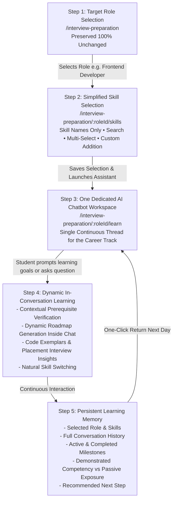
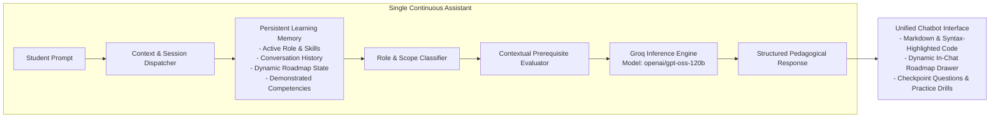
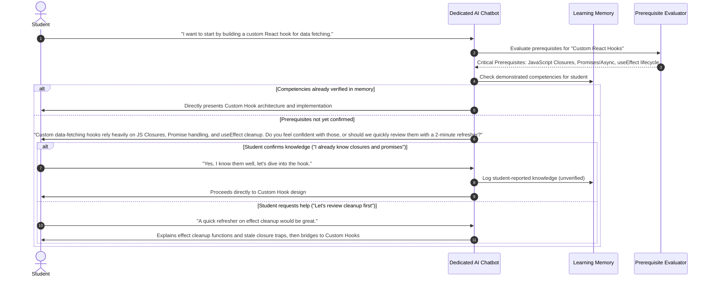
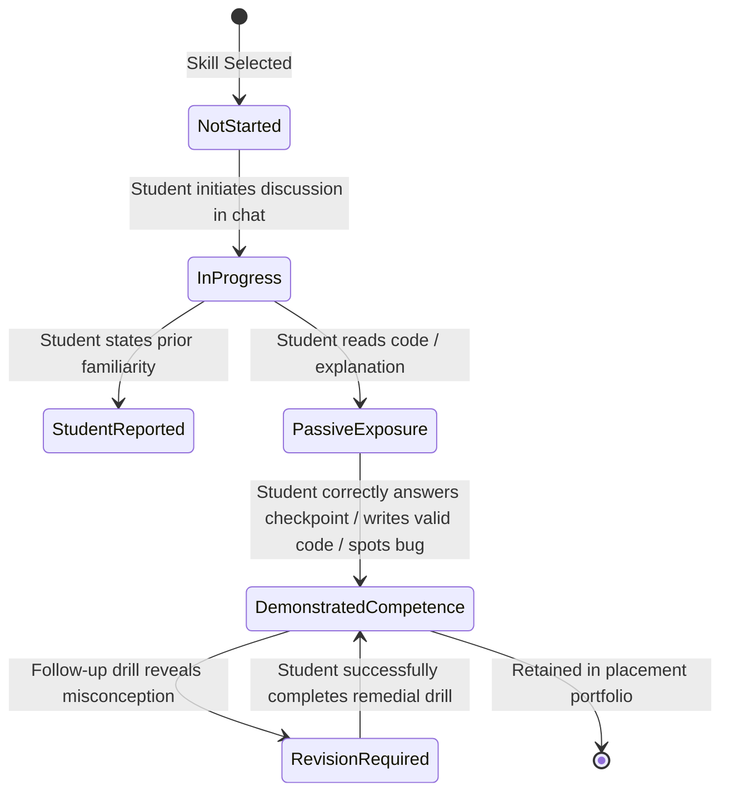
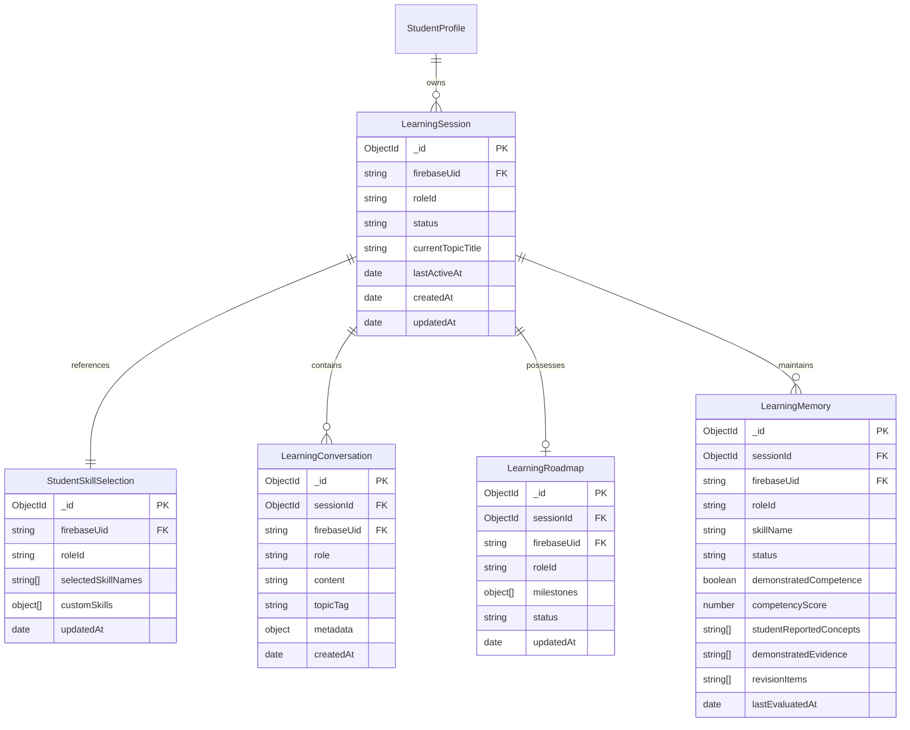
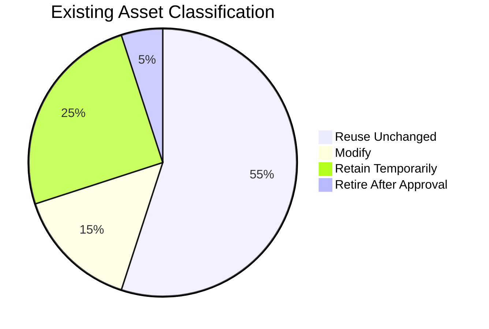
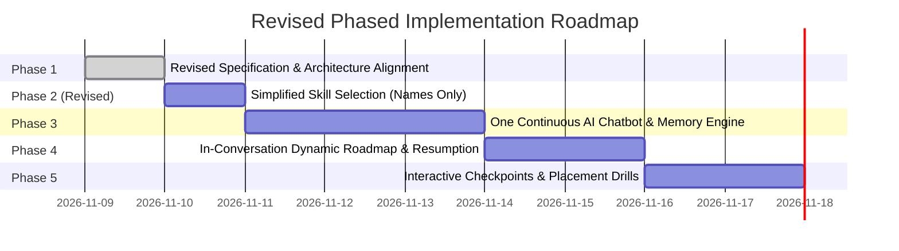

# CareerLaunch — Final Product Specification & Architecture Blueprint
# Role-Based AI Learning Platform — Architecture, Chatbot Engine & Migration Blueprint

> **Document Type**: Authoritative Product Architecture & System Specification  
> **Status**: APPROVED REVISED BLUEPRINT (PLANNING & ALIGNMENT ONLY — NO APPLICATION CODE MODIFIED)  
> **Core Direction**: Simple, role-based AI learning platform with **one continuous ChatGPT-like learning assistant per student and selected career track**.  
> **Pilot Track**: Frontend Developer (`frontend-developer`)  
> **Inference Engine**: Groq LPU Inference (`openai/gpt-oss-120b`)  
> **Backend Baseline**: MongoDB `careerlaunch` (port 27018), Node.js / Express, Firebase Authentication  
> **Supersedes**: All conflicting UI proposals, multi-chatbot schemes, onboarding roadmaps, and rigid linear sequencing from earlier drafts.

---

## 1. Executive Summary & Product Philosophy

CareerLaunch is an AI-powered interview preparation and continuous learning platform designed for ambitious software students preparing for competitive placement drives. 

### 1.1 The Core Problem
1. **Rigid Syllabus Trees**: Traditional platforms overwhelm students with massive, inflexible roadmaps before they even begin learning.
2. **Disconnected Micro-Chatbots**: Creating separate AI chat instances for each individual skill destroys conversational context, fragments learning history, and prevents students from naturally exploring how technologies connect.
3. **Passive Reading vs. Placement Readiness**: Passive scrolling through documentation does not prepare students for technical interviews where interviewers test edge cases, architectural trade-offs, and debugging reasoning.

### 1.2 The Final CareerLaunch Solution
- **Role Anchor**: The student selects a target career role (e.g., Frontend Developer). The platform strictly bounds all learning interactions to that professional role.
- **Simplified Skill Selection**: The student chooses what they need to master from a clean list of relevant skill names (e.g. React, CSS Layouts, Asynchronous JS, Next.js). No bulky subtopics, no descriptions, and no roadmaps appear at this stage.
- **One Dedicated AI Chatbot**: Exactly **one continuous learning conversation** per student for the selected career track. The student explores concepts, asks follow-up questions, inspects production code examples, and switches naturally between selected skills in a single cohesive thread.
- **Contextual Prerequisite Intelligence**: When a student asks to learn an advanced skill (e.g. React) before a foundational one (e.g. JavaScript), the AI checks whether they understand the core prerequisites. If the student confirms knowledge, it proceeds immediately; if they need help, it offers the fundamentals. The student always controls the order.
- **Dynamic In-Conversation Roadmap**: The learning roadmap is synthesized **inside the conversation** based on what the student wants to accomplish—never forced during initial onboarding.
- **Persistent Learning Memory**: The platform maintains durable memory across sessions, distinguishing between student-reported knowledge, topics in progress, and **actively demonstrated technical competency**.

---

## 2. Final Student Journey

The final student journey is straightforward, frictionless, and free of multi-step intake questionnaires:

$$\text{Target Role Selection} \longrightarrow \text{Skill Selection} \longrightarrow \text{One Dedicated AI Chatbot} \longrightarrow \text{Dynamic Learning} \longrightarrow \text{Persistent Learning Memory}$$



### Detailed Journey Steps:
1. **Target Role Selection (`/interview-preparation`)**: The student views the approved 8-card role catalog (Frontend Developer, Backend Developer, Full Stack Developer, Software Engineer, Data Analyst, Data Scientist, DevOps Engineer, Mobile App Developer). The page, styling, descriptions, and icons remain **100% unchanged**.
2. **Simplified Skill Selection (`/interview-preparation/:roleId/skills`)**: The student selects the technologies they want to learn or improve. The interface displays **skill names only** (no subtopics, no descriptions, no roadmaps, no lengthy text). Includes live search, multi-selection, and a custom skill addition field.
3. **One Dedicated AI Chatbot (`/interview-preparation/:roleId/learn`)**: A unified, distraction-free conversational workspace opens. The student chats naturally with their senior technical mentor for that role.
4. **Dynamic In-Conversation Learning**:
   - The student states what they want to tackle or asks a direct question.
   - The AI checks relevant prerequisites contextually (without rigid sequence locking).
   - The AI dynamically synthesizes and updates an interactive learning roadmap inside the workspace.
   - The student transitions seamlessly between selected skills (e.g., from CSS Flexbox to React Hooks to Next.js App Router) within the same conversation.
5. **Persistent Learning Memory**: The platform stores the full dialogue, roadmap state, demonstrated competencies, and revision items. Returning students resume immediately with complete memory intact.

---

## 3. Simplified Skill Selection Specification

The skill-selection screen serves as an intentional focus-setting tool, not a curriculum syllabus.

### 3.1 Strict Design & Content Rules
- **Display Skill Names Only**: Show concise, industry-standard skill titles (e.g., *"Box Model, Flexbox & CSS Grid"*, *"React Hooks"*, *"TypeScript Generics"*).
- **No Subtopics**: Subtopics are not displayed on this screen; they are introduced contextually by the chatbot.
- **No Descriptions**: No multi-sentence definitions or explanatory paragraphs.
- **No Roadmaps**: No timelines, module trees, or sequencing diagrams.
- **No Lengthy Explanations**: Clean, fast, glanceable selection interface.
- **Role Isolation**: Only skills relevant to the chosen role are displayed. Skills belonging to unrelated roles (e.g. Kubernetes in Frontend) are never shown.
- **Multiple Selection**: Students can select one, several, or all relevant skills.
- **Live Search**: Instant keyword filtering across skill names.
- **Custom Skill Addition**: A clean input field allowing students to enter specific tools or libraries (e.g., *"Tailwind CSS"*, *"Three.js"*, *"GraphQL"*).
- **Clear Selection State**: Prominent check indicators, a real-time selected count badge, removable summary chips, and a primary action button: **"Start Learning Assistant →"**.

### 3.2 Approved Frontend Developer Skill Inventory (Pilot Role)
For the Frontend Developer pilot track, the approved skill names from the canonical taxonomy are:

```
[HTML & Accessibility]
  • Semantic HTML5 & Landmark Elements
  • WCAG 2.1 & Keyboard Accessibility

[CSS & Layouts]
  • CSS Box Model, Flexbox & Grid
  • Responsive Design & Media Queries
  • Modern CSS: Variables & Modules

[JavaScript Core]
  • Execution Context, Scopes & Closures
  • Asynchronous JavaScript & Event Loop
  • DOM Architecture & Event Delegation

[TypeScript]
  • Static Typing & Type Annotations
  • Advanced Generics & Utility Types

[React Ecosystem]
  • JSX, Virtual DOM & Reconciliation
  • Component Architecture & Props
  • Core React Hooks (useState, useEffect, useRef)
  • Advanced Hooks & Custom Hooks
  • React Context API

[Modern Frameworks]
  • Next.js App Router & Server Components
  • Server Actions & Route Handlers

[State Management & Data]
  • Redux Toolkit (RTK) & Slices
  • Server State & Caching (TanStack Query)
  • Fetch API, Axios & REST Contracts
  • WebSockets & Real-Time Streams

[Browser & Security]
  • Client Storage: Cookies, LocalStorage, IndexedDB
  • Web Security: CORS, XSS & CSRF Defense

[Performance & Quality]
  • Core Web Vitals (LCP, INP, CLS)
  • Browser Rendering Pipeline (Reflow & Repaint)
  • Code Splitting & Dynamic Imports
  • Unit & Component Testing (Vitest / RTL)
  • Git Branching & Version Control
```

---

## 4. One Continuous Chatbot Architecture

CareerLaunch rejects the anti-pattern of creating separate chatbot instances for individual skills. A student preparing for a role requires a **single, unified conversational intelligence** that understands their complete role context and selected skills.



### 4.1 Chatbot Core Capabilities
1. **Natural Language Prompts**: Accepts unstructured, casual, or highly technical queries (e.g., *"Explain why my useEffect is running twice in React 18"*, *"Help me prepare for an SDE-1 frontend interview at Flipkart"*).
2. **Structured Educational Responses**:
   - Clear conceptual breakdown without bloated academic jargon.
   - Clean, production-grade code exemplars with comments, attributed to CareerLaunch Engineering.
   - Visual ASCII / mermaid diagrams for execution flow when helpful.
3. **Natural Skill Switching**: The student can seamlessly shift topics in the middle of a session:
   - *"We just covered closures, now can you show how closures cause stale state bugs in React useState?"*
   - *"Let's pause React for a moment and look at CSS Grid subgrid."*
   The assistant maintains the thread context without resetting or requiring a new session.
4. **Follow-Up Inquiries & Socratic Dialogue**: The assistant invites questions, tests edge cases, and guides students step-by-step through complex debugging scenarios.
5. **Interview Preparation Focus**: Every concept includes actionable placement interview framing:
   - *Why interviewers ask this question.*
   - *Common candidate mistakes.*
   - *Nuanced points that distinguish top candidates (e.g. performance implications, browser differences).*
6. **Dynamic In-Conversation Roadmap**: Rather than forcing a roadmap during onboarding, the assistant builds and updates an interactive roadmap **inside the chat workspace** as learning progresses.

---

## 5. Prerequisite Intelligence Engine

CareerLaunch features an **adaptive, non-blocking prerequisite intelligence system**.



### 5.1 Prerequisite System Principles
- **No Forced Linear Sequencing**: The student is never locked out of advanced topics. CareerLaunch respects student autonomy.
- **Contextual Verification**: If an advanced concept requires foundational understanding, the AI proactively identifies the dependency and asks the student to self-assess.
- **Intelligent Bridging**: When the student needs foundational help, the AI presents the prerequisite in the direct context of their target goal (e.g. explaining closures specifically through how they power React state).
- **Memory Integration**: If the student has already demonstrated competence in closures in an earlier turn, the AI skips redundant prerequisite checks.

---

## 6. Role & Skill Scope Enforcement

The platform enforces technical boundaries on the backend to maintain a disciplined, high-signal placement preparation environment.

### 6.1 Scope Boundary Matrix

| Category | Description | Assistant Handling |
|---|---|---|
| **Selected Skills** | Technologies explicitly chosen by the student (e.g., React, CSS Grid). | Full technical depth, code examples, placement interview questions. |
| **Necessary Prerequisites** | Foundational concepts required to understand selected skills (e.g., JS Closures for React Hooks). | Seamlessly supported with contextual bridging. |
| **Closely Related Tech** | Modern industry companions (e.g., TypeScript with React, Vite tooling, REST APIs). | Fully permitted and connected to the core discussion. |
| **Supporting Engineering** | General software engineering concepts (HTTP headers, browser caching, debugging tools). | Permitted through the lens of the target role. |
| **Unrelated Disciplines** | Questions belonging to outside tracks (e.g., Kubernetes cluster setup, training PyTorch models, iOS Swift lifecycle). | **Politely redirected** with a helpful pedagogical bridge. |
| **Non-Engineering Topics** | Creative writing, general trivia, politics, entertainment. | Strictly declined with a redirection back to interview preparation. |

### 6.2 Contextual Intent Classification (No Naive Keyword Blocking)
- **Why Keyword Blocking Fails**: A naive blacklist blocking the word `"server"` would erroneously reject a valid frontend question like *"How do Next.js Server Components differ from Client Components?"*.
- **Contextual Classification Pipeline**:
  1. The backend inspects the active role (`frontend-developer`) and selected skills.
  2. A lightweight prompt classification evaluates the *pedagogical intent* of the student's message against the role's scope.
  3. If the query touches another engineering discipline but has a direct frontend implication (e.g., *"What HTTP status code should the backend return for validation errors?"*), the assistant answers directly from the client application perspective.
  4. If the query is completely foreign, the assistant responds with an encouraging, polite redirection:
     > *"That is a core topic in Backend Distributed Systems, but our focus right now is your Frontend Developer placement track. Let's make sure your React and CSS fundamentals are bulletproof for upcoming interviews. If you'd like to prepare for backend engineering, you can switch tracks anytime from the role catalog."*

---

## 7. Persistent Learning Memory

CareerLaunch implements a durable learning memory model that differentiates between **passive exposure** and **demonstrated competence**.



### 7.1 Learning Memory Record Specification
Every student learning profile tracks:
1. **Selected Role**: The active career track (`roleId`).
2. **Selected Skills**: Array of active skill names.
3. **Full Conversation History**: Complete ordered turns with message timestamps, code snippets, and topic linkages.
4. **Dynamic Roadmap State**: Current milestone itinerary generated inside the chat, including:
   - Milestone titles and canonical topic IDs (`fe-top-X` when curriculum-aligned).
   - Order and priority.
   - Status: `not_started`, `in_progress`, `completed`, `revision_needed`.
5. **Current Learning Topic**: The exact technical concept actively being discussed.
6. **Student-Reported Knowledge**: Topics the student claimed to understand during prerequisite checks (flagged as self-reported, unverified).
7. **Demonstrated Competency**:
   - Explicitly verified achievements (e.g., solving an AI-presented coding exercise, correctly identifying an architectural bottleneck).
   - Scored on an objective 0–100 rubric with timestamp and evidence summary.
   - **Passive reading is never recorded as demonstrated competence.**
8. **Revision Requirements**: Concepts where the student hesitated, answered incorrectly, or requested later reinforcement.
9. **Recommended Next Learning Step**: A context-aware pointer generated by the AI indicating the ideal next milestone.

---

## 8. Database Model Strategy

To prevent database bloat and preserve backward compatibility with existing records, the new system introduces targeted collections that link cleanly to verified student identities.



### 8.1 Collection Specifications

#### 1. `StudentSkillSelection` (Enhanced & Simplified)
- `firebaseUid`: String (indexed)
- `roleId`: String (enum of 8 roles, indexed)
- `selectedSkillNames`: `[String]` — clean, flat array of selected skill names.
- `customSkills`: `[{ name: String, requestedAt: Date }]` — student-added skills.
- Unique Compound Index: `{ firebaseUid: 1, roleId: 1 }`.

#### 2. `LearningSession`
- `firebaseUid`: String (indexed)
- `roleId`: String (indexed)
- `status`: String (`'active'`, `'paused'`, `'completed'`)
- `currentTopicTitle`: String (active topic being explored)
- `lastActiveAt`: Date (indexed for quick dashboard resumption)
- Timestamps: `createdAt`, `updatedAt`

#### 3. `LearningConversation`
- `sessionId`: ObjectId ref `LearningSession` (indexed)
- `firebaseUid`: String (indexed)
- `role`: String (`'user'`, `'assistant'`, `'system'`)
- `content`: String (markdown, syntax-highlighted code blocks)
- `topicTag`: String (links the exchange to an active skill/milestone)
- `metadata`:
  - `tokens`: `{ prompt: Number, completion: Number, total: Number }`
  - `intent`: `{ isInScope: Boolean, detectedDomain: String, redirected: Boolean }`
  - `prerequisiteEvaluation`: `{ checked: Boolean, prerequisiteName: String, status: String }`
  - `citedChunks`: `[{ sourceId: String, docId: String, chunkId: String }]`
- `createdAt`: Date (indexed)

#### 4. `LearningRoadmap`
- `sessionId`: ObjectId ref `LearningSession` (indexed, unique)
- `firebaseUid`: String (indexed)
- `roleId`: String
- `milestones`: Array of:
  - `milestoneId`: String (e.g. `"m-1"`)
  - `title`: String (e.g. `"Mastering React Hooks & Stale Closures"`)
  - `officialTopicId`: String (nullable, e.g. `"fe-top-8"`)
  - `status`: String (`'not_started'`, `'in_progress'`, `'completed'`, `'revision_needed'`)
  - `orderIndex`: Number
- `status`: String (`'draft'`, `'active'`, `'completed'`)
- Timestamps: `createdAt`, `updatedAt`

#### 5. `LearningMemory`
- `sessionId`: ObjectId ref `LearningSession` (indexed)
- `firebaseUid`: String (indexed)
- `roleId`: String (indexed)
- `skillName`: String (indexed)
- `status`: String (`'not_started'`, `'in_progress'`, `'completed'`, `'revision_needed'`)
- `demonstratedCompetence`: Boolean (default: `false`)
- `competencyScore`: Number (0–100, default: `0`)
- `studentReportedConcepts`: `[String]`
- `demonstratedEvidence`: `[String]` (e.g., *"Successfully debugged dependency array memory leak"*)
- `revisionItems`: `[String]`
- `lastEvaluatedAt`: Date

---

## 9. API Contracts & Endpoints

All endpoints require an authenticated Firebase Bearer token verified via Express middleware (`requireAuth`). Student ownership is enforced via `req.user.uid === resource.firebaseUid`.

```
========================================================================================
METHOD  ENDPOINT                                                  PURPOSE
========================================================================================
GET     /api/learning/skills/:roleId                              Fetch flat skill names for role
GET     /api/learning/selection/:roleId                           Get student's saved skill selection
PUT     /api/learning/selection/:roleId                           Save simplified skill selection
----------------------------------------------------------------------------------------
POST    /api/learning/session/init                                Get or create continuous session
GET     /api/learning/session/:sessionId                          Fetch session & memory state
GET     /api/learning/session/latest?roleId=...                   One-click resumption lookup
----------------------------------------------------------------------------------------
POST    /api/learning/session/:sessionId/message                  Send message to continuous chatbot
GET     /api/learning/session/:sessionId/messages?limit=50        Retrieve conversation history
----------------------------------------------------------------------------------------
POST    /api/learning/session/:sessionId/roadmap/generate         Generate roadmap inside chat
GET     /api/learning/session/:sessionId/roadmap                  Fetch dynamic roadmap status
PUT     /api/learning/session/:sessionId/memory/checkpoint        Record demonstrated competency
GET     /api/learning/dashboard/resume                            Dashboard resumption widget data
========================================================================================
```

### 9.1 Endpoint Details

#### `GET /api/learning/skills/:roleId`
- **Response**:
  ```json
  {
    "success": true,
    "roleId": "frontend-developer",
    "roleTitle": "Frontend Developer",
    "skills": [
      "Semantic HTML5 & Landmark Elements",
      "WCAG 2.1 & Keyboard Accessibility",
      "CSS Box Model, Flexbox & Grid",
      "Responsive Design & Media Queries",
      "Modern CSS: Variables & Modules",
      "Execution Context, Scopes & Closures",
      "Asynchronous JavaScript & Event Loop",
      "DOM Architecture & Event Delegation",
      "Static Typing & Type Annotations",
      "Advanced Generics & Utility Types",
      "JSX, Virtual DOM & Reconciliation",
      "Component Architecture & Props",
      "Core React Hooks (useState, useEffect, useRef)",
      "Advanced Hooks & Custom Hooks",
      "React Context API",
      "Next.js App Router & Server Components",
      "Server Actions & Route Handlers",
      "Redux Toolkit (RTK) & Slices",
      "Server State & Caching (TanStack Query)",
      "Fetch API, Axios & REST Contracts",
      "WebSockets & Real-Time Streams",
      "Client Storage: Cookies, LocalStorage, IndexedDB",
      "Web Security: CORS, XSS & CSRF Defense",
      "Core Web Vitals (LCP, INP, CLS)",
      "Browser Rendering Pipeline (Reflow & Repaint)",
      "Code Splitting & Dynamic Imports",
      "Unit & Component Testing (Vitest / RTL)",
      "Git Branching & Version Control"
    ]
  }
  ```

#### `PUT /api/learning/selection/:roleId`
- **Request Body**:
  ```json
  {
    "selectedSkillNames": [
      "CSS Box Model, Flexbox & Grid",
      "Execution Context, Scopes & Closures",
      "Core React Hooks (useState, useEffect, useRef)",
      "Next.js App Router & Server Components"
    ],
    "customSkills": ["Tailwind CSS", "Three.js"]
  }
  ```
- **Response**: Returns saved record, sanitized and deduplicated.

#### `POST /api/learning/session/:sessionId/message`
- **Request Body**:
  ```json
  {
    "message": "I want to start with custom hooks, but can we review closures first?",
    "currentTopic": "Custom React Hooks"
  }
  ```
- **Processing**:
  1. Validates role scope and detects technical domain.
  2. Evaluates prerequisites (identifies JavaScript Closures as requested).
  3. Queries hybrid RAG retriever for grounding chunks when curriculum-aligned.
  4. Calls Groq LPU inference with `openai/gpt-oss-120b`.
  5. Records turns in `LearningConversation` and updates `LearningMemory`.
- **Response**:
  ```json
  {
    "success": true,
    "response": "...",
    "topicTag": "Execution Context, Scopes & Closures",
    "prerequisiteStatus": {
      "isPrerequisiteReview": true,
      "prerequisiteFor": "Advanced Hooks & Custom Hooks"
    },
    "metadata": {
      "tokens": { "total": 420 },
      "inScope": true
    }
  }
  ```

---

## 10. Existing System Migration Matrix

A strict principle of this architecture is **zero unnecessary rebuilds and zero data deletion**. Existing models, records, and services are audited and classified:



| Existing Asset | Location | Classification | Migration & Coexistence Strategy |
|---|---|---|---|
| **Role Catalog Page** | `src/pages/InterviewPreparationPage.jsx` | **Reuse Unchanged** | **100% Preserved**. All 8 role cards, descriptions, and styling remain untouched. Clicking Frontend Developer navigates to `/skills`. |
| **Role Definitions** | `src/data/interviewRoles.js` | **Reuse Unchanged** | Preserved authoritative metadata for the 8 career roles. |
| **Firebase Auth Subsystem** | `server/src/middleware/authMiddleware.js`, `src/lib/firebase.js`, `src/hooks/useAuth.js` | **Reuse Unchanged** | Preserved. All `/api/learning` routes use `requireAuth`. |
| **Groq LPU Client** | `server/src/services/ai/groqProvider.js`, `aiConfig.js` | **Reuse Unchanged** | Preserved. Continues using model `openai/gpt-oss-120b`. |
| **Canonical Lessons (20)** | MongoDB `generatedlessons` (16 SWE + 4 FE) | **Reuse Unchanged** | Preserved completely intact. Accessible for citation and deep-dive reading. |
| **Knowledge Sources & RAG** | MongoDB `knowledgesources`, `ingesteddocuments`, `contentchunks` | **Reuse Unchanged** | Preserved. 7 sources, 20 docs, 28 chunks remain active for hybrid retrieval. |
| **Curriculum Registry** | `server/src/services/ai/curriculumRegistry.js` | **Reuse Unchanged** | Preserved. Maps `fe-top-1` to `fe-top-17` for canonical grounding. |
| **Student Profiles** | MongoDB `studentprofiles` (2 existing) | **Reuse Unchanged** | Preserved intact. |
| **StudentSkillSelection** | `server/src/models/StudentSkillSelection.js` | **Modify** | Update to support flat `selectedSkillNames` alongside legacy `selectedSkills` for smooth transition. |
| **Skill Selection Page** | `src/pages/RoleSkillSelectionPage.jsx` | **Modify** | Streamline UI: remove category descriptions, subtopics, and lengthy explanations. Show clean skill names only with search and custom skill input. |
| **PreparationSession** | MongoDB `preparationsessions` (Phase B1) | **Retain Temporarily** | Preserved in MongoDB. Zero deletion. Existing `/setup` route remains reachable for backward compatibility. |
| **PreparationPlan** | MongoDB `preparationplans` (Phase B2) | **Retain Temporarily** | Preserved in MongoDB. Existing `/plan/:planId` route remains intact. In-conversation roadmap borrows proven validation logic from `planValidator.js`. |
| **DiagnosticSession** | MongoDB `diagnosticsessions` (Phase B2) | **Retain Temporarily** | Preserved in MongoDB. Diagnostic bank (`diagnosticBank.js`) is reused inside the chatbot for formative checkpoint questions. |
| **Static Module Sidebar** | `src/pages/InterviewPreparationPage.jsx` (old roadmap) | **Retire After Approval** | Replaced by the dynamic in-chat roadmap drawer once the continuous assistant is approved. |

---

## 11. Resolution of Contradictions with Earlier Blueprints

To establish absolute clarity, the following table resolves every point of friction between earlier proposals and the final approved specification:

| Feature Area | Earlier / Conflicting Proposals | Final Approved Specification (Superseding) | Rationale |
|---|---|---|---|
| **Skill Selection UI** | Verbose category cards with descriptions, subtopics, difficulty tags, and roadmap previews. | **Skill names only**. No subtopics, no descriptions, no roadmaps, no lengthy text. Includes search, multi-selection, and custom skill input. | Eliminates cognitive fatigue; students want to quickly select their skills and start learning immediately. |
| **Chatbot Scope & Structure** | Separate chatbot instances created per individual skill or topic. | **One continuous chatbot for the entire selected career track and chosen skills**. | A single conversation maintains holistic memory, enables cross-skill connections, and avoids fractured chat threads. |
| **Roadmap Timing** | Generating a complete fixed roadmap during onboarding before learning begins. | **Dynamic roadmap generated inside the conversation as learning progresses**. | Roadmaps created before speaking to the student are static guesses; in-conversation generation adapts to the student's live input. |
| **Prerequisite Handling** | Strict linear blocking (forcing students to complete JS before touching React). | **Contextual prerequisite intelligence without rigid sequencing**. AI checks knowledge, advises, and lets the student choose. | Adult learners have diverse backgrounds; forcing rigid sequences causes frustration. |
| **Scope Enforcement** | Hardcoded keyword blacklists. | **Contextual intent classification with explicit role/skill context and polite pedagogical bridges**. | Keyword filters break on valid cross-disciplinary questions (e.g. Next.js Server Components). |
| **Progress Tracking** | Counting page views or passive reading as milestone completion. | **Clear distinction: passive reading is NOT competence**. Competence requires demonstrated code, diagnostic, or debugging success. | Prepares students for real technical interviews where demonstrated ability is evaluated. |

---

## 12. Phased Implementation Roadmap & Acceptance Criteria



### Phase 1 — Specification & Architecture Alignment (Current Phase)
- **Goal**: Update and commit `docs/CAREERLAUNCH_NEW_PRODUCT_ARCHITECTURE_BLUEPRINT.md` reflecting the final specification.
- **Strict Constraint**: Architecture alignment and planning only. Zero code modified. Baseline database invariants strictly preserved.
- **Acceptance Criteria**:
  1. Blueprint comprehensively covers the 11 required sections.
  2. Contradictions with earlier proposals are explicitly resolved.
  3. Committed to git and reported to user. Stop condition met.

### Phase 2 (Revised) — Simplified Skill Selection Experience
- **Goal**: Implement the streamlined skill-selection interface.
- **Acceptance Criteria**:
  1. Displays **skill names only** for Frontend Developer (28 approved skills).
  2. Zero subtopics, descriptions, roadmaps, or lengthy text.
  3. Instant search filtering across skill names.
  4. Multiple selection with visual toggle and counter.
  5. Custom skill addition field with duplicate prevention.
  6. Backend endpoint updates for simplified skill names storage.
  7. Automated test verification and CDP screenshots.

### Phase 3 — One Continuous AI Chatbot & Memory Engine
- **Goal**: Build the unified conversational learning workspace for the role.
- **Acceptance Criteria**:
  1. Single continuous chat thread per student per role (`/interview-preparation/:roleId/learn`).
  2. Natural switching between selected skills in the same conversation.
  3. Groq LPU inference with `openai/gpt-oss-120b`.
  4. Contextual prerequisite intelligence (detects dependencies, asks student, bridges smoothly).
  5. Backend intent classifier enforcing role and skill scope with polite redirections.
  6. Multi-turn conversation persistence in `LearningConversation`.

### Phase 4 — Dynamic In-Conversation Roadmap & Continuity
- **Goal**: In-conversation roadmap generation and persistent learning memory.
- **Acceptance Criteria**:
  1. Roadmap generated dynamically inside the chat workspace based on conversational context.
  2. Collapsible side drawer displaying milestones and real-time progress.
  3. Distinct tracking for student-reported knowledge vs. demonstrated competency.
  4. Dashboard one-click resumption card restoring conversation and roadmap state.

### Phase 5 — Interactive Placement Checkpoints & Coding Drills
- **Goal**: Embed formative placement drills directly inside the chat.
- **Acceptance Criteria**:
  1. Socratic check questions, code debugging exercises, and interview follow-ups.
  2. Objective scoring updating `demonstratedCompetence` in `LearningMemory`.

---

## 13. Technical Stack Verification

The system continues using CareerLaunch's proven production stack:
- **Frontend**: React 19, Vite, JavaScript (JSX), Plain CSS (Warm Ivory `#FAF8F5`/`#F6F2E9`, Deep Forest `#1E3D34`/`#24372F`, Muted Terracotta `#C45A3C`/`#C66A4A`, Soft Sage `#8FA89B`/`#879477`, Charcoal `#2B2927`, Sand `#E8E4DC`). Zero Tailwind, zero TypeScript.
- **Backend**: Node.js, Express, MongoDB with Mongoose (port 27018, database `careerlaunch`).
- **Authentication**: Firebase Authentication with Admin SDK token verification.
- **Inference Provider**: Groq Cloud LPU inference (`openai/gpt-oss-120b`).
- **Retrieval Engine**: Hybrid keyword + vector reciprocal rank fusion (RRF) over verified W3C, WHATWG, ECMA, and NIST sources. Provider-independent architecture.

---

## 14. Strict Stop Condition Met

In strict compliance with instructions:
- **Planning and architecture alignment only.**
- **Zero application code, UI components, routes, database models, or student records were modified.**
- **Zero lessons were generated or documents ingested.**
- **All existing database invariants remain strictly preserved.**

Standing by for user review and explicit approval before implementing the revised Phase 2.
