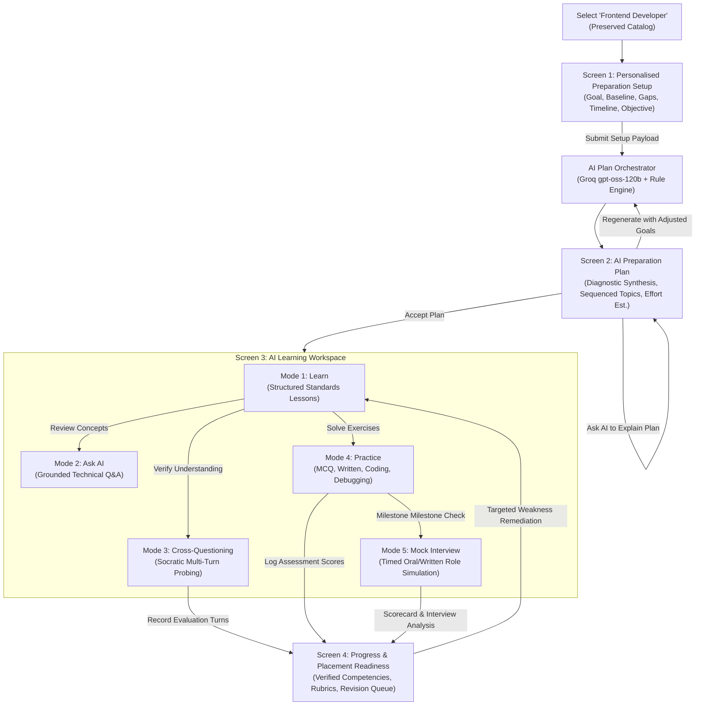
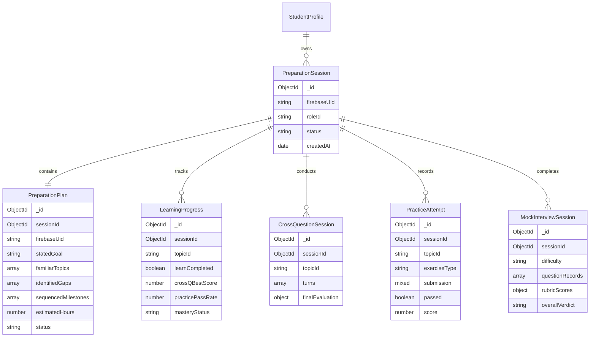
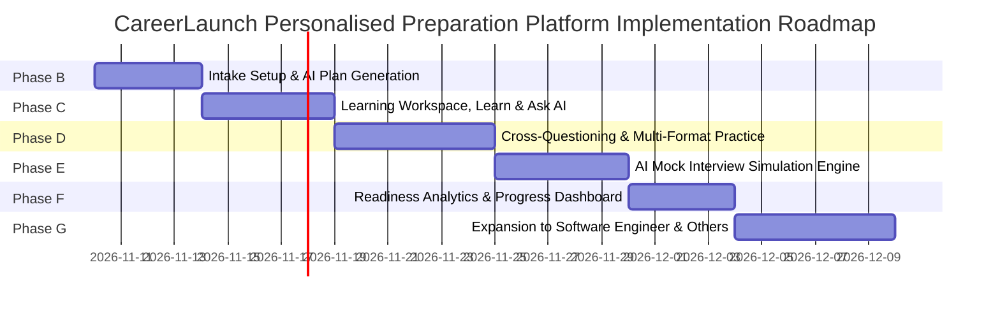

# CareerLaunch — Phase A: Complete Product Architecture & UX Redesign Blueprint

> **Document Version**: 1.0.0  
> **Status**: APPROVED ARCHITECTURAL BLUEPRINT (READ-ONLY PLANNING PHASE)  
> **Target Audience**: Product Engineering, AI Architects, UX/UI Designers  
> **First Pilot Track**: Frontend Developer Specialization  
> **Design Philosophy**: High Signal-to-Noise Ratio, Evidence-Based Assessment, Editorial Warmth  

---

## 1. Product Vision & Requirements

### 1.1 Executive Overview
CareerLaunch is evolving from a static career roadmap and standalone lesson browser into an **AI-powered, personalised placement preparation platform**. While static roadmaps inform candidates about *what* exists in the industry, they fail to bridge the critical gap between passive reading and demonstrated technical competence during competitive campus placements and technical hiring rounds.

The new CareerLaunch platform transforms passive curriculum browsing into an active, personalised, and verifiable preparation journey:
1. **Goal-Calibrated Intake**: Students articulate their specific target (e.g. upcoming campus placement, off-campus internship, frontend round in 3 weeks).
2. **Diagnostic Gap Synthesis**: The system evaluates stated knowledge against industry expectations to formulate an adaptive, sequenced learning plan.
3. **Structured Pedagogical Grounding**: High-quality lessons grounded in verified canonical web standards (WHATWG, W3C, ECMA).
4. **Contextual AI Assistance**: Topic-bounded technical mentorship without hallucinations or generic conversational drift.
5. **Adaptive Socratic Cross-Questioning**: Dynamic, single-turn probing that tests deep conceptual understanding and exposes rote memorization.
6. **Multi-Format Technical Practice**: Objective questions, written architectural explanations, code prediction, and bug-fixing exercises.
7. **Role-Calibrated Mock Interviews**: Structured technical interview simulations with multi-metric rubrics and feedback.
8. **Evidence-Based Placement Readiness**: A deterministic, tamper-proof readiness index calculated strictly from verified assessment attempts—never from passive reading or unvalidated self-reporting.

### 1.2 First Pilot Specialization: Frontend Developer
The Frontend Developer roadmap (`fe-top-1` through `fe-top-17`) serves as the inaugural pilot track for this end-to-end architecture. The foundational Batch 1 lessons (`fe-top-1` through `fe-top-4`) have already been generated, validated against open standards, and deployed to MongoDB. This provides an immediately operational knowledge grounding for the new personal preparation workflows.

### 1.3 Core Product Principles
- **Editorial Rigor & Warmth**: Maintain CareerLaunch's signature serif-accented typography and warm palette (`#F6F2E9`, `#24372F`, `#C66A4A`). No cold generic AI chat wrappers.
- **Strict Evidence-Based Mastery**: Passive lesson reads and self-selected skill levels are labeled as *Stated Knowledge*. Only scored assessments, cross-questioning passes, and mock interview performance contribute to *Verified Mastery*.
- **High Signal-to-Noise Ratio**: AI interactions are purpose-driven and structured into dedicated workspace modes rather than a sprawling, unfocused chatbot.
- **Deterministic Evaluation with AI Assistance**: Critical data ownership, scoring math, access control, and progress state remain deterministic in Node.js/MongoDB. AI (Groq `openai/gpt-oss-120b`) is utilized exclusively for qualitative evaluation, natural language dialogue, and contextual synthesis.

---

## 2. Preserved System Core (Zero-Change Surface)

### 2.1 Approved "Choose Your Target Role" Catalog
The existing **Role Selection Page** (`/interview-preparation`) is strictly approved and **must remain 100% unchanged in layout, visual styling, typography, and card interactions**.

```
+------------------------------------------------------------------------------------------------------+
|                                   CAREERLAUNCH APPROVED ROLE CATALOG                                 |
|                                         (PRESERVED 100% UNCHANGED)                                   |
+------------------------------------------------------------------------------------------------------+
|  [ Frontend Developer ]    [ Backend Developer ]    [ Full Stack Developer ]    [ Software Engineer ] |
|  [ Data Analyst ]          [ Data Scientist ]       [ DevOps Engineer ]         [ Mobile App Dev ]    |
+------------------------------------------------------------------------------------------------------+
```

**Preservation Invariants**:
1. **Catalog Path**: `/interview-preparation` continues to render the 8-role grid.
2. **Visual Components**: The hero banner (`Prepare with purpose.`), feature pills (8 tracks, 56 modules, 117 topics), and role cards (`.prep-role-card`) preserve their exact CSS classes, hover animations, and icons.
3. **Role Card Click Behavior**: Clicking any role continues to pass `role.id`. For the Frontend Developer track, selection transitions the student smoothly into the new **Personalised Preparation Setup** journey, while non-pilot roles continue to access their existing comprehensive roadmaps.
4. **Design Tokens**: Strict adherence to `src/styles/variables.css` without alteration.

---

## 3. Complete Student Journey

### 3.1 End-to-End Workflow Diagram



### 3.2 Journey Step Walkthrough
1. **Step 1: Role Activation**: Candidate clicks "Frontend Developer" on `/interview-preparation`. The system checks if an active `PreparationPlan` already exists. If yes, it offers a quick resume; otherwise, it opens Screen 1.
2. **Step 2: Intake & Diagnosis**: Candidate fills the setup form or uses the one-click quick topic selector. Stated skills from their student profile are automatically pre-loaded as selectable chips.
3. **Step 3: Plan Review & Calibration**: Candidate reviews the generated schedule, understanding *why* topics are ordered in a specific sequence (e.g. JavaScript Closures before React Custom Hooks). Candidate can fine-tune hours, add elective topics, or ask the AI why a topic was prioritized.
4. **Step 4: Active Workspace Engagement**: The candidate works topic-by-topic. They study standard-grounded explanations, interrogate difficult concepts via Ask AI, defend their understanding in Cross-Questioning, and solve real code puzzles in Practice mode.
5. **Step 5: Assessment & Mock Interviewing**: Upon completing a curriculum milestone, the candidate takes an interactive Mock Interview simulating a real technical hiring round.
6. **Step 6: Verified Readiness**: The candidate inspects their Readiness Dashboard to view concrete proof of placement preparedness for recruiters and campus placement cells.

---

## 4. Screen-by-Screen UX Specifications

### 4.1 Screen 1 — Personalised Preparation Setup (`/interview-preparation/frontend-developer/setup`)

```
+------------------------------------------------------------------------------------------------------+
| BREADCRUMBS: Interview Prep / Frontend Developer / Preparation Setup                                |
+------------------------------------------------------------------------------------------------------+
| [Sparkles] PERSONALIZED PREPARATION SETUP                                                            |
| Target Specialization: FRONTEND DEVELOPER TRACK                                                      |
| Build your calibrated learning itinerary tailored to your current gaps, target date, and interview goals. |
+------------------------------------------------------------------------------------------------------+
| 1. WHAT DO YOU WANT TO PREPARE FOR?                                                                  |
| +--------------------------------------------------------------------------------------------------+ |
| | [Textarea: 4-6 lines]                                                                            | |
| | e.g. "I want to prepare React.js for a frontend developer interview. I know HTML, CSS and        | |
| | JavaScript basics. I understand some React Hooks but struggle with state management and           | |
| | performance optimisation."                                                                       | |
| +--------------------------------------------------------------------------------------------------+ |
| [Tip] Or select a specific topic directly:                                                          |
| [Chip: HTML Semantics] [Chip: CSS Grid & Flexbox] [Chip: Closures & Scope] [Chip: React Hooks] ...   |
|                                                                                                      |
| 2. YOUR CURRENT EXPERIENCE LEVEL                                                                     |
| ( ) Beginner (College Core)    (*) Intermediate (Some Projects)    ( ) Advanced (Industry Ready)    |
|                                                                                                      |
| 3. TOPICS YOU ALREADY FEEL CONFIDENT IN (Pre-populated from your profile skills)                      |
| [x] HTML5 Semantics   [x] CSS Selectors   [x] Basic DOM Manipulation   [ ] Closures   [ ] React     |
| [+ Add custom topic tag]                                                                             |
|                                                                                                      |
| 4. TOPICS YOU STRUGGLE WITH OR WANT TO EMPHASIZE                                                    |
| [x] Redux / Zustand State Management   [x] Core Web Vitals & Performance   [x] CSS Grid Systems     |
| [+ Add custom challenge tag]                                                                         |
|                                                                                                      |
| 5. PREPARATION TIMELINE & URGENCY                 6. PRIMARY OBJECTIVE                               |
| [Dropdown: 4 Weeks (Standard Placement Prep) v]  [Dropdown: Upcoming Campus Placement Drive v]     |
|                                                                                                      |
| [Secondary: Cancel & Browse Static Roadmap]      [Primary: Generate My Preparation Plan ->]          |
+------------------------------------------------------------------------------------------------------+
```

#### Field Specifications & Profile Reuse:
- **Reused Profile Attributes**:
  - `StudentProfile.fullName`: Personalized welcoming address.
  - `StudentProfile.skills`: Automatically converted into default "Already Familiar" selectable tags.
  - `StudentProfile.technologies`: Populates candidate's established technology stack.
  - `StudentProfile.education.graduationYear`: Informs timeline urgency and difficulty baseline.
- **Excluded Attributes**: Zero collection of redundant PII (no contact numbers, physical addresses, or financial data).
- **Direct Topic Shortcut**: For students with immediate urgent needs, clicking a topic chip bypasses the long prompt and pre-fills an optimal single-topic deep dive.

---

### 4.2 Screen 2 — AI Preparation Plan (`/interview-preparation/frontend-developer/plan`)

```
+------------------------------------------------------------------------------------------------------+
| BREADCRUMBS: Interview Prep / Frontend Developer / Preparation Plan                                 |
+------------------------------------------------------------------------------------------------------+
| [Target] PREPARATION PLAN: FRONTEND DEVELOPER SPECIALIZATION                                         |
| Goal: "React.js interview preparation focusing on state management and performance optimization"     |
| Timeline: 4 Weeks  |  Estimated Effort: 28 Hours (~7 hrs/week)  |  Target Readiness: 85%+ Placement   |
+------------------------------------------------------------------------------------------------------+
| DIAGNOSTIC SYNTHESIS & GAP ANALYSIS                                                                  |
| +---------------------------------------------------+----------------------------------------------+ |
| | Stated Baseline Strengths (Self-Reported)         | Identified Knowledge Gaps & Interview Risks  | |
| | - HTML5 Semantics & Basic Accessibility           | - Advanced Closure Memory Leaks & Scopes     | |
| | - CSS Flexbox 1-D Layout Systems                  | - React Fiber Reconciliation & Commit Phase  | |
| | - Basic JavaScript Promises & Fetch               | - Asynchronous State Synchronization         | |
| +---------------------------------------------------+----------------------------------------------+ |
|                                                                                                      |
| SEQUENCED LEARNING CURRICULUM (4 MILESTONES)                                                         |
|                                                                                                      |
| [-] MILESTONE 1: Modern DOM, Box Model & Scope Foundations (Week 1 - 7 Hours)                       |
|   |-- [ ] fe-top-2: CSS Box Model, Flexbox & Grid Systems [Beginner | 2.5 hrs] [Self-Reported]       |
|   |-- [ ] fe-top-4: Execution Context, Scopes & Closures [Beginner | 3.0 hrs] [Gap Priority]        |
|   \-- [x] Milestone 1 Assessment: 10 MCQs + 1 Written Architecture Question                         |
|                                                                                                      |
| [+] MILESTONE 2: Asynchronous Runtime & React Core Architecture (Week 2 - 8 Hours)                  |
| [+] MILESTONE 3: Complex State, Caching & Performance Profiling (Week 3 - 7 Hours)                   |
| [+] MILESTONE 4: Placement Mock Interviews & System Design Review (Week 4 - 6 Hours)                 |
|                                                                                                      |
| INTERACTIVE PLAN ACTIONS                                                                             |
| [Button: + Add Topic]  [Button: Ask AI to Explain Plan]  [Button: Customize Schedule]  [Regenerate]   |
|                                                                                                      |
| [Secondary: Save Draft & Return]                [Primary: Accept Plan & Open Learning Workspace ->]  |
+------------------------------------------------------------------------------------------------------+
```

#### Plan Interactivity Specifications:
- **Explain Recommendations**: Clicking "Ask AI to Explain Plan" surfaces a modal explaining pedagogical dependency chains (e.g. *"Closures and execution contexts must precede React hooks because `useEffect` captures variables over render cycles"*).
- **Plan Customization**: Students can toggle optional elective modules, reorder sequence items, or adjust allocated weekly study hours.
- **Reporting Status Indicators**:
  - `Stated / Unverified`: Light grey pill indicating candidate self-report.
  - `Curriculum Gap`: Terracotta pill highlighting a critical interview risk.
  - `Verified Competency`: Sage green badge indicating an assessment has been passed.

---

### 4.3 Screen 3 — AI Learning Workspace (`/interview-preparation/frontend-developer/workspace`)

The Workspace operates as a cohesive, 3-column responsive learning cockpit with a persistent left navigation, a primary central activity area, and a collapsible contextual AI mentorship drawer.

```
+------------------------------------------------------------------------------------------------------+
| TOP NAV: [Logo] CareerLaunch | Track: Frontend Developer | Plan Progress: 18% | [Avatar] Tripti D.   |
+------------------------------------------------------------------------------------------------------+
| LEFT SIDEBAR (280px)  | MAIN ACTIVITY STAGE (Flexible)                | RIGHT AI DRAWER (360px)      |
|                       |                                               |                              |
| [Preparation Itinerary]| MODE SELECTOR TAB BAR:                        | [Sparkles] CONTEXTUAL MENTOR |
| Milestone 1: Baseline | [ Learn ] [ Ask AI ] [ Cross-Q ] [ Practice ] | Mode: Contextual Assistance  |
| > fe-top-1: Semantics |                                               | Topic: fe-top-1 Semantics    |
|   fe-top-2: Box Model | ACTIVE VIEW: [MODE 1: LEARN]                  |                              |
|   fe-top-4: Closures  |                                               | "Welcome! I am grounded in   |
|                       | # Semantic Markup & Accessibility Outlines    | WHATWG HTML Living Standards.|
| Milestone 2: React    | Difficulty: Beginner | Est: 45 Mins          | Ask me to explain landmark   |
|   fe-top-6: React Core|                                               | roles or contrast <section>  |
|   fe-top-8: Hooks     | ## 1. Learning Objectives                     | vs <article>."               |
|                       | - Implement semantic landmarks (nav, main)    |                              |
| MODE SHORTCUTS:       | - Build compliant Accessibility Trees         | [Student Prompt Box]         |
| [L] Learn             |                                               | > "Why does a screen reader  |
| [A] Ask AI            | ## 2. Core Concepts & Living Standards       | need <main> instead of div?" |
| [Q] Cross-Questioning | Grounded in WHATWG HTML Sections §4.3...      |                              |
| [P] Practice (3 New)  |                                               | [AI Response - Grounded]:    |
| [M] Mock Interview    | ## 3. Practical Example                       | "Under WHATWG Section 4.3.4, |
|                       | ```html                                       | <main> maps to landmark role |
| [Collapse Sidebar <]  | <header>...</header><main>...</main>          | 'main', enabling users to    |
|                       | ```                                           | bypass repeated navigation." |
|                       | [Author: CareerLaunch Engineering]            |                              |
|                       |                                               | [Ask Follow-up Question ->]  |
+------------------------------------------------------------------------------------------------------+
```

#### Detailed Specification of the 5 Workspace Modes:

#### Mode 1: Learn
- **Engine**: Directly reuses the validated Phase 6.1 `GeneratedLesson` repository and `LessonContentView` component.
- **Capabilities**: Full 9-section structure, KaTeX complexity notations ($O(1)$, $O(n)$), interactive syntax-highlighted code exemplars, and verified citation cards linking to canonical source standards.
- **Integrity**: Excludes internal token counts, prompt templates, and raw chunk IDs from student view.

#### Mode 2: Ask AI (Topic-Bounded Mentorship)
- **Engine**: Groq `openai/gpt-oss-120b` with bounded RAG evidence context injection.
- **Capabilities**:
  - Contextual conversation anchored strictly to the active topic.
  - "Simplify Explanation" (for beginners) and "Deep Technical Dive" (for interview edge cases).
  - "Give an Alternative Code Example" (authored dynamically under CareerLaunch Engineering guidelines).
  - Explicit bounding: If a candidate asks questions unrelated to software engineering or frontend development, the assistant politely declines and redirects focus to the active topic.

#### Mode 3: Cross-Questioning (Socratic Interrogation)
- **Objective**: Expose memorization and test whether the candidate can articulate technical trade-offs.
- **Workflow**:
  1. AI poses **one probing conceptual question** at a time (e.g. *"Under what circumstances does a browser combine adjoining vertical margins, and how does `display: flow-root` alter this behavior?"*).
  2. Student submits their explanation in writing.
  3. AI evaluates technical accuracy, depth, and clarity against the canonical standard.
  4. AI dynamically generates an adaptive follow-up based on the answer (if correct $\rightarrow$ increases difficulty; if misconception detected $\rightarrow$ probes the exact flaw).
  5. After 3–5 turns, session concludes with a structured **Debrief Report**: Verified Strengths, Technical Misconceptions, and Targeted Review Recommendations.

#### Mode 4: Practice (Multi-Format Assessments)
Supports four distinct exercise categories:
1. **Multiple Choice & True/False**: Conceptual bisection tests with instant standard citations explaining why options are correct or incorrect.
2. **Written Architectural Prompts**: Subjective questions (e.g. *"Explain how React batches multiple setState calls inside an event handler vs setTimeout in React 18"*). Evaluated against a 4-point rubric: Completeness, Correct Terminology, Edge-Case Awareness, Clarity.
3. **Coding Puzzles**:
   - *Complete the Function*: Write the missing implementation matching unit tests.
   - *Predict the Output*: Determine console output of tricky scope/asynchronous code snippets.
   - *Bug Hunting & Repair*: Identify and fix broken CSS layout rules or closure memory leaks.
4. **Debugging Scenarios**: Given a misbehaving component snippet and an error trace, identify the root cause and provide the corrective diff.
*Note: Excludes heavyweight virtual IDE containers. All exercises run lightweight JavaScript/CSS validation in-browser or execute unit test assertions.*

#### Mode 5: Mock Interview (Placement Simulation)
- **Format**: Timed, turn-based technical interview simulation calibrated to hiring rounds at top tech employers.
- **Configuration**:
  - Track: Frontend Developer Specialization.
  - Focus Area: Comprehensive (Core JS, React Architecture, Layouts, Performance).
  - Duration: 20 Minutes (Express) or 45 Minutes (Full Round).
  - Difficulty: Campus Placement / Junior SDE-1 / Mid-level Frontend.
- **Engine**: Single-turn pacing where the AI maintains an interviewer persona (probing, professional, structured).
- **Scorecard Rubric**:
  - Technical Accuracy & Depth (40%)
  - Problem Solving & Structure (25%)
  - Communication Clarity & Terminology (20%)
  - Edge Case Awareness & Optimization (15%)
  - Overall Placement Recommendation: `Strong Hire`, `Hire`, `Leaning Hire`, `Needs Revision`.

---

### 4.4 Screen 4 — Progress and Readiness Dashboard (`/interview-preparation/frontend-developer/progress`)

```
+------------------------------------------------------------------------------------------------------+
| BREADCRUMBS: Interview Prep / Frontend Developer / Placement Readiness                              |
+------------------------------------------------------------------------------------------------------+
| [Award] PLACEMENT READINESS SCORE: 74% (STRONG CANDIDATE)                                            |
| Calculated strictly from 14 verified assessments, 3 cross-questioning passes, and 1 mock interview.  |
| Stated (Self-Reported) Knowledge: 88%  |  Demonstrated (Verified) Mastery: 74%                      |
+------------------------------------------------------------------------------------------------------+
|                                                                                                      |
| 1. EVIDENCE-BASED COMPETENCY MATRIX                                                                  |
| +------------------------------------+------------------+---------------------+--------------------+ |
| | Technical Topic                    | Stated Baseline  | Verified Assessment | Current Status     | |
| +------------------------------------+------------------+---------------------+--------------------+ |
| | fe-top-1: Semantic Markup & a11y   | Intermediate     | 95% (MCQ + Code)    | [VERIFIED MASTERED]| |
| | fe-top-2: CSS Box Model & Grid     | Intermediate     | 82% (Cross-Q Debrief)| [VERIFIED MASTERED]| |
| | fe-top-4: Scopes & Closures        | Beginner         | 68% (Practice Quiz) | [NEEDS REVISION]   | |
| | fe-top-6: React Core Mechanics     | Intermediate     | Not Attempted       | [PENDING TEST]     | |
| +------------------------------------+------------------+---------------------+--------------------+ |
|                                                                                                      |
| 2. MOCK INTERVIEW PERFORMANCE HISTORY                                                                |
| - 2026-11-08: Frontend SDE-1 Technical Round (35 Mins) -> RATING: 78/100 (Hire)                     |
|   Strengths: CSS Grid specifications, semantic landmark roles.                                       |
|   Key Growth Areas: Closure memory retention during event listener unbinding.                        |
|                                                                                                      |
| 3. TARGETED REVISION RECOMMENDATIONS                                                                 |
| [Action Card]: Review `fe-top-4` Closure Memory Leaks -> Re-attempt 2 Debugging Exercises [Start ->] |
+------------------------------------------------------------------------------------------------------+
```

---

## 5. Navigation & Routing Architecture

### 5.1 Route Hierarchy

| Route Path | View / Component | Access Level | Purpose |
| :--- | :--- | :--- | :--- |
| `/interview-preparation` | `InterviewPreparationPage` (Catalog) | Protected | **Preserved 8-role catalog** |
| `/interview-preparation/:roleId` | `RoleCurriculumPage` / Redirect | Protected | Full curriculum syllabus for role |
| `/interview-preparation/:roleId/setup` | `PreparationSetupPage` | Protected | Screen 1: Goal and intake setup |
| `/interview-preparation/:roleId/plan` | `PreparationPlanPage` | Protected | Screen 2: AI plan review & edit |
| `/interview-preparation/:roleId/workspace` | `LearningWorkspacePage` | Protected | Screen 3: Main learning cockpit |
| `/interview-preparation/:roleId/progress` | `PlacementReadinessPage` | Protected | Screen 4: Evidence-based progress |
| `/interview-preparation/:roleId/topic/:topicId` | *Workspace Redirection Proxy* | Protected | **Legacy route compatibility** |

### 5.2 Legacy Deep-Link Preservation Strategy
Existing links to lessons (e.g. `/interview-preparation/software-engineer/topic/swe-top-1` or `/interview-preparation/frontend-developer/topic/fe-top-1`) must **never break**. 
When a request arrives at `/interview-preparation/:roleId/topic/:topicId`:
1. If the student has an active session, it redirects smoothly to `/interview-preparation/:roleId/workspace?mode=learn&topic=:topicId`.
2. If accessed directly without an active plan, the workspace opens in **Standalone Lesson Preview** mode, displaying the full lesson and rendering a banner inviting the student to *"Activate Personalised Plan for this Track"*.

---

## 6. Frontend Component Architecture

### 6.1 Directory & Component Organization (React 19 + Plain CSS)

```
src/
├── components/
│   └── interview/
│       ├── LessonContentView.jsx             [PRESERVED: 9-Section Structured Lesson]
│       ├── setup/
│       │   ├── PreparationSetupForm.jsx       [Screen 1 Intake Form]
│       │   ├── TopicQuickSelectGrid.jsx       [Screen 1 Direct Topic Selector]
│       │   └── SkillTagSelector.jsx           [Profile Skill Multi-Select Chips]
│       ├── plan/
│       │   ├── PreparationPlanView.jsx        [Screen 2 Plan Review & Milestone List]
│       │   ├── DiagnosticGapCard.jsx          [Screen 2 Stated vs Gap Matrix]
│       │   └── PlanCustomizerModal.jsx        [Screen 2 Topic Edit & Reorder Modal]
│       ├── workspace/
│       │   ├── WorkspaceSidebar.jsx           [Left Navigation, Progress & Modes]
│       │   ├── WorkspaceHeader.jsx            [Top Bar, Mode Switcher, Session Info]
│       │   ├── LearnModeView.jsx              [Mode 1: Wraps LessonContentView]
│       │   ├── AskAIModeView.jsx              [Mode 2: Bounded Topic Q&A Assistant]
│       │   ├── CrossQuestionModeView.jsx      [Mode 3: Socratic Dialogue Engine]
│       │   ├── PracticeModeView.jsx           [Mode 4: Multi-format Assessment Host]
│       │   ├── MockInterviewModeView.jsx      [Mode 5: Timed Interview Simulation]
│       │   └── ContextualAIDrawer.jsx         [Collapsible Right Mentorship Drawer]
│       └── progress/
│           ├── ReadinessScoreHeader.jsx       [Screen 4 Score & Metric Overview]
│           ├── CompetencyMatrixTable.jsx      [Screen 4 Stated vs Verified Matrix]
│           └── RevisionActionQueue.jsx        [Screen 4 Remediation Recommendations]
├── pages/
│   ├── InterviewPreparationPage.jsx           [PRESERVED 100%: 8-Role Catalog]
│   ├── PreparationSetupPage.jsx               [NEW: Screen 1 Container]
│   ├── PreparationPlanPage.jsx                [NEW: Screen 2 Container]
│   ├── LearningWorkspacePage.jsx              [NEW: Screen 3 Container]
│   └── PlacementReadinessPage.jsx             [NEW: Screen 4 Container]
└── styles/
    ├── variables.css                          [PRESERVED: Core Palette Tokens]
    ├── interview-setup.css                    [NEW: Screen 1 Plain CSS]
    ├── interview-plan.css                     [NEW: Screen 2 Plain CSS]
    ├── interview-workspace.css                [NEW: Screen 3 Plain CSS]
    └── interview-progress.css                 [NEW: Screen 4 Plain CSS]
```

### 6.2 Styling Rules & Token Enforcement
- **Strictly Plain CSS**: Zero Tailwind classes, zero CSS-in-JS dependencies.
- **Color Variables**: 
  - Backgrounds: `var(--color-ivory)`, `var(--color-ivory-dark)`, `var(--color-forest)`.
  - Text: `var(--color-charcoal)`, `var(--color-charcoal-muted)`, `#FBF9F4`.
  - Brand Accents: `var(--color-terracotta)`, `var(--color-sage)`, `var(--color-forest)`.
- **Typography**: Editorial headings using `var(--font-serif)` (`Newsreader`), body interface elements using `var(--font-sans)` (`Plus Jakarta Sans`), code using `var(--font-mono)`.
- **Responsive Layouts**: Desktop 3-column grid (`280px 1fr 360px`), Tablet 2-column with drawer overlay (`240px 1fr`), Mobile single-column with bottom sheet navigation.

---

## 7. Backend Service Architecture & Data Flow

```mermaid
flowchart LR
    subgraph Client["Frontend Client (React 19)"]
        UI["Workspace & Assessment Views"]
    end

    subgraph Middleware["API Gateway & Security"]
        AuthMid["authMiddleware.js<br/>(Firebase Admin ID Token)"]
        OwnerMid["verifySessionOwnership.js<br/>(Student ID Validation)"]
    end

    subgraph Controllers["Express Controllers"]
        PrepCtrl["preparationController.js"]
        CrossQCtrl["crossQuestionController.js"]
        PracticeCtrl["practiceController.js"]
        MockCtrl["mockInterviewController.js"]
        ReadinessCtrl["readinessController.js"]
    end

    subgraph Services["Core Application Services"]
        PlanOrch["planOrchestrator.js<br/>(Intake Diagnosis & Sequencing)"]
        CrossQEng["crossQuestionEngine.js<br/>(Socratic Turns & Rubric)"]
        PracticeEval["practiceEvaluator.js<br/>(Deterministic + AI Code Check)"]
        MockEng["mockInterviewManager.js<br/>(Interview Turns & Scoring)"]
        ReadinessCalc["readinessCalculator.js<br/>(Deterministic Placement Index)"]
    end

    subgraph AI["AI Infrastructure"]
        Groq["groqProvider.js<br/>(Groq gpt-oss-120b JSON Mode)"]
        RAG["hybridRetriever.js<br/>(Standards Chunks)"]
    end

    subgraph Storage["MongoDB Collections (Port 27018)"]
        M1[("preparationsessions")]
        M2[("preparationplans")]
        M3[("practiceattempts")]
        M4[("crossquestionsessions")]
        M5[("mockinterviewsessions")]
        M6[("generatedlessons (20 Docs)")]
        M7[("contentchunks (28 Chunks)")]
    end

    UI -->|Bearer JWT| AuthMid --> OwnerMid
    OwnerMid --> Controllers
    Controllers --> Services
    Services --> AI
    Services --> Storage
```



---

## 8. Proposed Database Models & Relationships

### 8.1 Schema Architecture Principles
1. **Separation of Concerns**: Canonical learning materials (`GeneratedLesson`, `ContentChunk`, `KnowledgeSource`) remain shared, immutable, and read-only. Candidate-specific state resides in dedicated student-scoped collections.
2. **Private Data Ownership**: Every student collection contains an indexed `firebaseUid` field. No student can query, update, or inspect another student's attempts.
3. **No Redundant Over-Normalization**: Keep attempt records compact and embedded where appropriate to avoid heavy relational JOIN overhead in MongoDB.

### 8.2 Model Specifications



#### 1. `PreparationSession` (`server/src/models/PreparationSession.js`)
```javascript
{
  firebaseUid: { type: String, required: true, index: true },
  roleId: { type: String, required: true, enum: ['frontend-developer', 'software-engineer', /* ... */] },
  status: { type: String, enum: ['active', 'paused', 'completed'], default: 'active' },
  targetDate: { type: Date },
  primaryObjective: { type: String, enum: ['placement', 'internship', 'interview_prep', 'skill_upgrade'] },
  activePlanId: { type: Schema.Types.ObjectId, ref: 'PreparationPlan' },
  createdAt: { type: Date, default: Date.now },
  updatedAt: { type: Date, default: Date.now }
}
```

#### 2. `PreparationPlan` (`server/src/models/PreparationPlan.js`)
```javascript
{
  sessionId: { type: Schema.Types.ObjectId, ref: 'PreparationSession', required: true, index: true },
  firebaseUid: { type: String, required: true, index: true },
  roleId: { type: String, required: true },
  statedGoal: { type: String, required: true },
  experienceLevel: { type: String, enum: ['beginner', 'intermediate', 'advanced'] },
  diagnosticSummary: {
    familiarTopics: [{ type: String }],
    identifiedGaps: [{ type: String }],
    synthesisReasoning: { type: String }
  },
  milestones: [
    {
      milestoneIndex: { type: Number, required: true },
      title: { type: String, required: true },
      weekNumber: { type: Number },
      topics: [
        {
          topicId: { type: String, required: true },
          title: { type: String, required: true },
          difficulty: { type: String, enum: ['beginner', 'intermediate', 'advanced'] },
          estimatedHours: { type: Number },
          priorityReason: { type: String },
          isSelfReportedFamiliar: { type: Boolean, default: false }
        }
      ]
    }
  ],
  totalEstimatedHours: { type: Number, required: true },
  isAccepted: { type: Boolean, default: false },
  version: { type: Number, default: 1 }
}
```

#### 3. `CrossQuestionSession` (`server/src/models/CrossQuestionSession.js`)
```javascript
{
  sessionId: { type: Schema.Types.ObjectId, ref: 'PreparationSession', required: true, index: true },
  firebaseUid: { type: String, required: true, index: true },
  topicId: { type: String, required: true },
  turns: [
    {
      turnIndex: { type: Number, required: true },
      aiQuestion: { type: String, required: true },
      studentResponse: { type: String, required: true },
      aiEvaluation: {
        score: { type: Number, min: 0, max: 10 },
        accuracyAssessment: { type: String },
        detectedMisconceptions: [{ type: String }],
        technicalStrengths: [{ type: String }]
      },
      durationMs: { type: Number }
    }
  ],
  finalDebrief: {
    overallMasteryScore: { type: Number, min: 0, max: 100 },
    verifiedStrengths: [{ type: String }],
    recommendedRevisions: [{ type: String }],
    passed: { type: Boolean, default: false }
  },
  completedAt: { type: Date }
}
```

#### 4. `PracticeAttempt` (`server/src/models/PracticeAttempt.js`)
```javascript
{
  sessionId: { type: Schema.Types.ObjectId, ref: 'PreparationSession', required: true, index: true },
  firebaseUid: { type: String, required: true, index: true },
  topicId: { type: String, required: true, index: true },
  exerciseType: { type: String, enum: ['mcq', 'written', 'code_completion', 'code_prediction', 'debugging'], required: true },
  exercisePrompt: { type: String, required: true },
  studentSubmission: { type: Schema.Types.Mixed, required: true },
  passed: { type: Boolean, required: true },
  score: { type: Number, min: 0, max: 100 },
  feedback: {
    correctSolution: { type: String },
    explanation: { type: String },
    rubricEvaluation: { type: Object }
  },
  createdAt: { type: Date, default: Date.now }
}
```

#### 5. `MockInterviewSession` (`server/src/models/MockInterviewSession.js`)
```javascript
{
  sessionId: { type: Schema.Types.ObjectId, ref: 'PreparationSession', required: true, index: true },
  firebaseUid: { type: String, required: true, index: true },
  roleId: { type: String, required: true },
  difficulty: { type: String, enum: ['entry', 'associate', 'mid_level'], default: 'entry' },
  durationMinutes: { type: Number, required: true },
  questions: [
    {
      questionIndex: { type: Number, required: true },
      topicId: { type: String },
      questionText: { type: String, required: true },
      studentAnswer: { type: String, required: true },
      followUpQuestions: [{ type: String }],
      scoreOutOf10: { type: Number }
    }
  ],
  scorecard: {
    technicalDepthScore: { type: Number, min: 0, max: 100 },
    problemSolvingScore: { type: Number, min: 0, max: 100 },
    communicationScore: { type: Number, min: 0, max: 100 },
    overallScore: { type: Number, min: 0, max: 100 },
    hiringVerdict: { type: String, enum: ['Strong Hire', 'Hire', 'Leaning Hire', 'Needs Revision'] },
    executiveSummary: { type: String }
  },
  createdAt: { type: Date, default: Date.now }
}
```

---

## 9. API Endpoint Specifications

All endpoints require standard `Authorization: Bearer <Firebase_ID_Token>`.

### 9.1 Preparation Setup & Planning Endpoints

#### `POST /api/prep/setup`
- **Description**: Submits student intake data and returns initial diagnostic synthesis.
- **Request Body**:
  ```json
  {
    "roleId": "frontend-developer",
    "goalPrompt": "I want to prepare React.js for campus placement. I know HTML/CSS but struggle with state and performance.",
    "experienceLevel": "intermediate",
    "familiarTopics": ["fe-top-1", "fe-top-2"],
    "struggleTopics": ["fe-top-4"],
    "timelineWeeks": 4,
    "primaryObjective": "placement"
  }
  ```
- **Response (201 Created)**:
  ```json
  {
    "success": true,
    "sessionId": "6af1a42b9fc73efb22d69801",
    "planId": "6af1a42b9fc73efb22d69802",
    "diagnosticSummary": {
      "familiarCount": 2,
      "gapCount": 3,
      "synthesis": "Candidate has foundational layout literacy but critical gaps in execution context and state synchronization."
    }
  }
  ```

#### `GET /api/prep/plan/:planId`
- **Description**: Retrieves full sequenced milestones and diagnostic details of a preparation plan.
- **Response (200 OK)**: Full `PreparationPlan` payload.

#### `POST /api/prep/plan/:planId/accept`
- **Description**: Marks the plan as accepted and activates the student's active workspace session.

#### `PUT /api/prep/plan/:planId/customize`
- **Description**: Allows adding, removing, or re-ordering topics within the plan.

---

### 9.2 Learning Workspace & Mentorship Endpoints

#### `GET /api/prep/workspace/:sessionId`
- **Description**: Retrieves current workspace state, active milestone, topic checklist, and progress indicators.

#### `POST /api/prep/chat`
- **Description**: Executes contextual, source-grounded Ask AI conversation for the active topic.
- **Request Body**:
  ```json
  {
    "sessionId": "6af1a42b9fc73efb22d69801",
    "topicId": "fe-top-1",
    "message": "Why does a screen reader require landmark roles instead of generic divs?",
    "history": []
  }
  ```
- **Response (200 OK)**:
  ```json
  {
    "success": true,
    "reply": "Under WHATWG HTML Sections §4.3.4, landmark elements like <main> and <nav> populate the browser's Accessibility Tree...",
    "citedSources": ["https://html.spec.whatwg.org/multipage/sections.html"],
    "tokenUsage": { "totalTokens": 412 }
  }
  ```

---

### 9.3 Cross-Questioning Endpoints

#### `POST /api/prep/cross-question/start`
- **Request Body**: `{ "sessionId": "...", "topicId": "fe-top-4" }`
- **Response (200 OK)**: First probing question and `crossQuestionSessionId`.

#### `POST /api/prep/cross-question/turn`
- **Description**: Submits candidate's answer; receives AI evaluation and the next adaptive question.
- **Request Body**:
  ```json
  {
    "crossQuestionSessionId": "...",
    "turnIndex": 1,
    "studentResponse": "Closures happen when an inner function remembers variables from its outer lexical scope even after the outer function has returned."
  }
  ```
- **Response (200 OK)**:
  ```json
  {
    "success": true,
    "turnEvaluation": {
      "score": 8,
      "strengths": ["Clear identification of lexical environment retention"],
      "gaps": ["Did not mention heap memory persistence vs stack frame destruction"]
    },
    "nextQuestion": "If closures keep variables in memory, how can an uncleaned event listener inside a closure cause a memory leak?",
    "isFinalTurn": false
  }
  ```

#### `POST /api/prep/cross-question/conclude`
- **Description**: Generates final debrief, updates verified competency records, and provides review recommendations.

---

### 9.4 Practice & Mock Interview Endpoints

#### `GET /api/prep/practice/:topicId/exercises`
- **Description**: Retrieves grounded practice exercises (MCQs, written questions, code completion puzzles).

#### `POST /api/prep/practice/submit`
- **Description**: Evaluates student practice attempt (deterministic assertions for code; AI rubric evaluation for written answers).

#### `POST /api/prep/mock-interview/start`
- **Request Body**: `{ "sessionId": "...", "roleId": "frontend-developer", "difficulty": "entry", "durationMinutes": 30 }`

#### `POST /api/prep/mock-interview/submit-turn`
- **Description**: Records student interview answer and generates the next conversational question.

#### `POST /api/prep/mock-interview/finish`
- **Description**: Computes comprehensive scorecard across all four evaluation rubrics.

---

### 9.5 Readiness & Analytics Endpoints

#### `GET /api/prep/readiness/:sessionId`
- **Description**: Returns deterministic placement readiness percentage, competency matrix, and targeted revision items.

---

## 10. AI Engine & Prompt Architecture

### 10.1 Structured Orchestration Engine

```
+------------------------------------------------------------------------------------------------------+
|                                   GROQ LPU ORCHESTRATION PIPELINE                                    |
|                                       (Model: openai/gpt-oss-120b)                                   |
+------------------------------------------------------------------------------------------------------+
| [1. Intake Diagnosis]       | Analyzes stated goals + profile -> Outputs JSON gap matrix             |
| [2. Plan Generator]         | Synthesizes sequenced milestones with calibrated hour estimates        |
| [3. Contextual Ask AI]      | Bounded RAG retrieval over verified web standards (WHATWG/W3C/ECMA)    |
| [4. Socratic Cross-Q]       | Dynamic single-turn probing; adapts difficulty based on accuracy       |
| [5. Rubric Evaluator]       | Grades written answers & interview turns against 4-point rubrics       |
| [6. Mock Interview Persona] | Conducts professional, structured technical interview simulations      |
+------------------------------------------------------------------------------------------------------+
```

### 10.2 System Prompt Templates & Schemas

#### Template 1: Diagnostic Gap & Plan Synthesis
```markdown
You are CareerLaunch's Chief Technical Curriculum Architect.
Analyze the student's preparation goal for the {roleTitle} specialization track.

STATED GOAL: {goalPrompt}
EXPERIENCE LEVEL: {experienceLevel}
STATED FAMILIAR TOPICS: {familiarTopics}
STATED STRUGGLE TOPICS: {struggleTopics}
TIMELINE: {timelineWeeks} weeks ({primaryObjective})

AVAILABLE CURRICULUM TOPICS:
{availableTopicsList}

INSTRUCTIONS:
1. Identify genuine conceptual gaps based on industry hiring expectations.
2. Order topics into logical pedagogical milestones (foundations -> frameworks -> performance -> interview).
3. Distinguish self-reported familiar topics from unverified knowledge.
4. Output MUST be valid JSON adhering strictly to the PreparationPlan schema.
```

#### Template 2: Socratic Cross-Questioning Turn Engine
```markdown
You are a Staff Software Engineer conducting a 1-on-1 Socratic technical evaluation on: {topicTitle}.
Grounded Standard Evidence: {retrievedEvidence}

CURRENT TURN: {turnIndex} of {maxTurns}
PREVIOUS QUESTION: {previousQuestion}
CANDIDATE RESPONSE: {candidateResponse}

INSTRUCTIONS:
1. Evaluate the candidate's response for technical correctness and depth (Score 0-10).
2. Check for rote memorization: Did they explain WHY the mechanism works, or just repeat buzzwords?
3. If they showed mastery, ask a harder edge-case question. If they made a technical error, probe the error without giving away the answer immediately.
4. Respond in JSON with evaluation, strengths, gaps, and the next single probing question.
```

#### Template 3: Mock Interviewer Persona
```markdown
You are a Principal Engineering Interviewer conducting a campus placement technical interview for a {roleTitle} position.
Maintain a professional, encouraging, but rigorous interview persona.

TOPIC IN FOCUS: {topicTitle}
DIFFICULTY LEVEL: {difficulty}

INSTRUCTIONS:
1. Ask one realistic interview question at a time.
2. When the candidate responds, acknowledge the answer briefly and follow up with a deeper technical inquiry or move to the next topic.
3. Do NOT provide lectures or verbose answers during the interview. Keep candidate talking time > 70%.
```

### 10.3 AI Safety & Grounding Guardrails
- **Zero Hallucination Protocol**: For factual claims and standards questions, the AI must cite specific chunks in the evidence package.
- **Prompt Injection Defense**: All user inputs are sanitized and wrapped in unambiguous delimiter tags (`<candidate_input>...</candidate_input>`). System instructions explicitly ignore embedded override commands.
- **PII Stripping**: Only anonymized candidate academic level and technical goals are sent to Groq. Student names, email addresses, phone numbers, and college names are never passed to the LLM.
- **Deterministic Math Guard**: Placement readiness percentages and test pass rates are computed deterministically in JavaScript—never estimated by the LLM.

---

## 11. Security, Privacy & Data Ownership

### 11.1 Access Control Matrix

| Entity | Read Access | Write Access | Ownership Rule |
| :--- | :--- | :--- | :--- |
| `GeneratedLesson` | All Authenticated Students | System / Admin Only | Canonical Public Resource |
| `KnowledgeSource` | All Authenticated Students | System / Admin Only | Canonical Public Resource |
| `PreparationPlan` | Session Owner Only | Session Owner Only | `firebaseUid === req.user.uid` |
| `CrossQuestionSession` | Session Owner Only | Session Owner Only | `firebaseUid === req.user.uid` |
| `PracticeAttempt` | Session Owner Only | Session Owner Only | `firebaseUid === req.user.uid` |
| `MockInterviewSession` | Session Owner Only | Session Owner Only | `firebaseUid === req.user.uid` |

### 11.2 Authentication Middleware Enforcement
All `/api/prep/*` routes pass through `requireAuth` (`server/src/middleware/authMiddleware.js`), which verifies the cryptographic signature of the Firebase ID token. Handlers enforce that `req.user.uid` matches the resource's `firebaseUid`. Any attempt to inspect another student's session immediately aborts with `HTTP 403 Forbidden`.

---

## 12. Existing-System Preservation & Backward Compatibility

### 12.1 Explicit System Invariants

| System Component | Existing Status | Redesign Policy | Verification Method |
| :--- | :--- | :--- | :--- |
| **Role Catalog Page** | 8 Roles Grid (`/interview-preparation`) | **100% UNCHANGED** | Visual snapshot matching & CSS class verification |
| **8 Role Roadmaps** | 56 modules, 117 topics | **Preserved intact** | `interviewRoadmaps.js` exported constants untouched |
| **20 Generated Lessons** | 16 SWE + 4 FE in MongoDB | **Preserved intact** | ObjectIds and timestamps verified untouched |
| **Deferred Topics** | `se-top-1`, `se-top-14` | **Preserved unavailable** | HTTP 404 & `available: false` maintained |
| **Ingested Corpus** | 7 Sources, 20 Docs, 28 Chunks | **Preserved intact** | MongoDB collection count checks |
| **Student Profiles** | Exactly 2 records in MongoDB | **Preserved intact** | Document count and ObjectId integrity checks |
| **Database Engine** | MongoDB on Port 27018 | **Preserved intact** | No URI, port, or schema migration changes |

---

## 13. Phase B–G Implementation Roadmap



### Phase B: Personalised Preparation Setup & Plan Generation
- **Scope**: Screen 1 (`PreparationSetupPage`) & Screen 2 (`PreparationPlanPage`).
- **Deliverables**:
  - `PreparationSession` and `PreparationPlan` Mongoose models.
  - Setup form with profile skill auto-population and direct topic shortcuts.
  - Backend `planOrchestrator.js` utilizing Groq `openai/gpt-oss-120b` JSON mode.
  - Interactive plan review, topic reordering, and "Explain Plan" modal.
- **Acceptance Criteria**: Student submits goal prompt; receives sequenced 4-milestone plan; accepts plan; session activates in MongoDB.

### Phase C: AI Learning Workspace (Learn & Ask AI Modes)
- **Scope**: Screen 3 core layout, Left Sidebar, Learn Mode, and Contextual Ask AI Drawer.
- **Deliverables**:
  - `LearningWorkspacePage` 3-column responsive layout with mode switcher.
  - Integration of existing `LessonContentView` inside Learn mode.
  - Bounded `AskAIModeView` anchored to active topic with RAG standard chunks.
  - Backward-compatible URL redirection for legacy lesson routes.
- **Acceptance Criteria**: Seamless navigation between curriculum topics; lesson rendered without delay; Ask AI provides standard-grounded technical answers.

### Phase D: Interactive Cross-Questioning & Multidimensional Practice
- **Scope**: Mode 3 (Cross-Questioning) & Mode 4 (Practice) in Screen 3.
- **Deliverables**:
  - `CrossQuestionSession` & `PracticeAttempt` models.
  - Socratic turn engine (`crossQuestionEngine.js`) with dynamic difficulty adaptation.
  - Practice view supporting MCQs, written answers, code prediction, and bug fixing.
  - In-browser test runner and AI rubric grading for written responses.
- **Acceptance Criteria**: Multi-turn dialogue records turns correctly; student answers evaluated against rubrics; debrief report accurately highlights strengths and misconceptions.

### Phase E: AI Technical Mock Interview System
- **Scope**: Mode 5 (Mock Interview) in Screen 3.
- **Deliverables**:
  - `MockInterviewSession` model and `mockInterviewManager.js`.
  - Timed interview turn orchestrator with candidate talk-time tracking.
  - Post-interview comprehensive evaluation scorecard across 4 rubrics.
- **Acceptance Criteria**: Complete 20-minute simulated interview; generates actionable feedback and hiring verdict without prompt breakages.

### Phase F: Progress Dashboard & Placement Readiness Analytics
- **Scope**: Screen 4 (`PlacementReadinessPage`).
- **Deliverables**:
  - Deterministic readiness scoring engine (`readinessCalculator.js`).
  - Stated vs Verified Competency Matrix table.
  - Targeted remediation action cards linking directly back to Workspace Learn mode.
- **Acceptance Criteria**: Verified readiness score updates dynamically upon completing practice and cross-questioning; zero reliance on unverified self-reporting.

### Phase G: Role Expansion (Software Engineer & Remaining Tracks)
- **Scope**: Scaling the personalized preparation engine to Software Engineer, Backend Developer, and the remaining 6 tracks.
- **Deliverables**:
  - Automated intake prompt adapters for Software Engineer topics.
  - Cross-role readiness tracking.

---

## 14. Testing & Acceptance Criteria Matrix

| Phase | Test Category | Target Metrics & Invariants | Automated Test Script |
| :--- | :--- | :--- | :--- |
| **Phase B** | API & Plan Schema | 100% valid JSON matching `PreparationPlan` schema; zero PII leakage | `server/src/scripts/testPhaseBPlan.js` |
| **Phase C** | Workspace & Routes | Desktop (1440px) & mobile responsive; legacy lesson URLs resolve | `scripts/capture_phaseC_workspace.cjs` |
| **Phase D** | Cross-Q & Practice | Socratic difficulty shifts correctly; code test assertions pass | `server/src/scripts/testPhaseDPractice.js` |
| **Phase E** | Mock Interview | Interview completes in 4-6 turns; rubric scores 0-100; valid hiring verdict | `server/src/scripts/testPhaseEMock.js` |
| **Phase F** | Readiness Math | Readiness score strictly $\le 100\%$; deterministic calculation | `server/src/scripts/testPhaseFReadiness.js` |
| **All** | Baseline Security | 16 SWE lessons, 2 students, and 8 role catalog 100% UNTOUCHED | `server/src/scripts/testPhase6Batch1.js` |

---

## 15. Risks, Dependencies & Unresolved Questions

### 15.1 Identified Risks & Mitigations

| Risk | Impact | Architectural Mitigation Strategy |
| :--- | :--- | :--- |
| **Groq TPM Rate Limits (8,000 TPM)** | High | 1. Cache common practice questions and plan templates in MongoDB.<br/>2. Enforce 20s inter-turn rate limiter in interactive modes.<br/>3. Handle HTTP 429 with automated exponential backoff. |
| **Arbitrary Code Execution in Practice** | Critical | **Zero server-side code execution**. Practice exercises execute via lightweight client-side sandboxed evaluation (pure function input/output checks, regex analysis, and AST linting). |
| **Subjective Evaluation Drift in AI Grading** | Medium | Anchor written answer evaluations to explicit 4-point rubrics with concrete factual criteria derived from standard specs. |
| **Student Drop-off on Long Setup Prompts** | Medium | Offer **Direct Topic Quick-Select Chips** that pre-fill optimal single-topic deep dive sessions with one click. |

### 15.2 Key Dependencies
- Groq Cloud API with active `openai/gpt-oss-120b` model availability.
- Local MongoDB running on Port 27018 with active `careerlaunch` database.
- Firebase Admin SDK for cryptographic token verification.

### 15.3 Open Design Questions for Review
1. **Mock Interview Speech Input**: While Phase E specifies written conversational turns to ensure immediate reliability, should a browser-native Web Speech API (speech-to-text) layer be introduced as an optional toggle in Phase E?
2. **Readiness Recalibration Frequency**: Should verified competency scores decay over time (e.g. after 30 days without review) to encourage spaced repetition, or remain permanent until re-tested?

---

*Architectural blueprint prepared and validated for CareerLaunch Product Redesign.*
