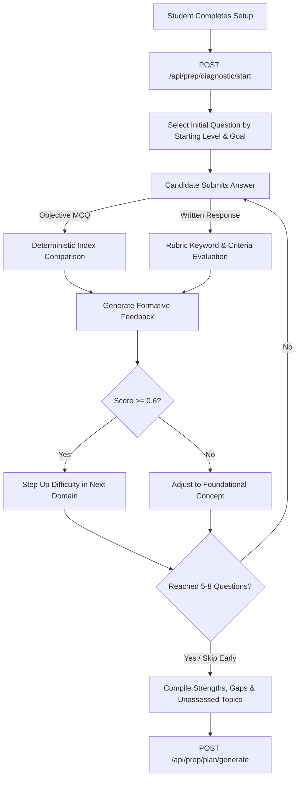

# CareerLaunch — Phase B2: AI Diagnostic & Personalised Preparation Plan Report

> **Phase**: B2 (AI Diagnostic & Personalised Preparation Plan)  
> **Status**: COMPLETED & VERIFIED  
> **Target Specialization**: Frontend Developer (`frontend-developer` pilot track)  
> **LLM Engine**: Groq LPU Inference  
> **Model**: `openai/gpt-oss-120b` (Reasoning & Structured Synthesis)  
> **Strict Stop Condition**: Phase B2 complete; no Learn workspace, Ask AI chat, cross-questioning, practice engines, or mock interviews implemented; awaiting user approval.  

---

## 1. Executive Summary

Phase B2 delivers the core intelligence of CareerLaunch's interview preparation platform. Building upon the verified Phase B1 intake setup and Pre-B2 searchable multi-select topic dropdown, Phase B2 establishes the next stage in the student journey:

$$\text{Preparation Setup} \longrightarrow \text{Adaptive Knowledge Diagnostic} \longrightarrow \text{AI Preparation Plan} \longrightarrow \text{Review \& Customise} \longrightarrow \text{Accept Plan}$$

### Key Capabilities Delivered:
1. **Adaptive Knowledge Diagnostic (`/interview-preparation/frontend-developer/diagnostic`)**:
   - Covers 8 core frontend domains: HTML & Accessibility, CSS & Responsive Design, JavaScript Fundamentals, DOM & Asynchronous JS, React Fundamentals, React Hooks, State Management, and Frontend Performance & Debugging.
   - Dynamic difficulty adaptation: step-ups on correct answers (`beginner` $\to$ `intermediate` $\to$ `advanced`), foundational adjustments on incorrect answers.
   - Deterministic objective grading for MCQs; structured rubric evaluation (criteria matching and keyword analysis) for written responses.
   - Candidate controls: 1 question at a time, skip individual question, or skip/exit diagnostic entirely (which marks diagnostic as skipped and applies experience-appropriate defaults).
   - Formative feedback provided after each question with architectural explanations.
   - Outcome compilation: separates **demonstrated strengths**, **demonstrated gaps**, **unassessed curriculum topics**, and **student-reported knowledge**.

2. **Real Groq AI Personalised Plan Generation (`POST /api/prep/plan/generate`)**:
   - Synthesized using Groq model `openai/gpt-oss-120b` in JSON Object mode.
   - Enforces valid official curriculum topic IDs (`fe-top-1` through `fe-top-17`); zero invented or hallucinated official IDs.
   - Explicit custom topic handling: recognizes student-added topics (e.g. Next.js, Redux Toolkit, TypeScript) and checks database knowledge sources. Because official approved sources are not yet ingested for these custom topics, they are explicitly flagged with `knowledgeSupportStatus: 'source_review_required'`, zero fabricated citations, and clear guidance that complete AI lessons are pending future source review.
   - Curriculum topics with verified ingested sources (`fe-top-1` to `fe-top-4`) are badged as `verified`; other official curriculum topics are badged as `roadmap_topic`.
   - Strict schema validation (`planValidator.js`): invalid AI responses are safely rejected; failed generations never overwrite valid or accepted plans.

3. **Interactive Plan Customization & Acceptance (`/interview-preparation/frontend-developer/plan/:planId`)**:
   - Displays preparation overview, starting level, recommended duration, weekly study effort, calibrated knowledge assessment, ordered learning milestones, weekly schedule, and recommended practice activities.
   - Candidate controls: move milestones up/down to reorder, remove milestones, add custom milestones via modal, regenerate plan via Groq, and accept the final plan.
   - On acceptance (`POST /api/prep/plan/:planId/accept`), displays celebration confirmation banner confirming that the itinerary is locked and ready for learning stage (without prematurely redirecting to an unfinished workspace).

4. **Rigorous Security & Data Invariants**:
   - All diagnostic and plan endpoints require Firebase authentication (`requireAuth`) and enforce ownership checks against verified `req.user.uid` (cross-student access yields HTTP 403 Forbidden).
   - Preserves all 20 existing generated lessons (16 SWE + 4 FE), 2 student profiles, 7 knowledge sources, 20 ingested documents, and 28 content chunks.

---

## 2. Files Created and Modified

### 2.1 Backend Models
- **`server/src/models/DiagnosticSession.js`** (Created):
  - Mongoose schema tracking student-scoped diagnostic sessions.
  - Fields: `firebaseUid`, `sessionId`, `roleId`, `status` (`in_progress`, `completed`, `skipped`), `questions` array (storing prompts, options, correct indices, rubrics, student answers, scores, and formative feedback), `currentIndex`, `maxQuestions`, `demonstratedStrengths`, `demonstratedGaps`, `unassessedTopics`, `diagnosticScore`.
- **`server/src/models/PreparationPlan.js`** (Created):
  - Mongoose schema for personalised preparation plans.
  - Fields: `firebaseUid`, `sessionId`, `diagnosticId`, `roleId`, `status` (`draft`, `customized`, `accepted`), `overview`, `knowledgeAssessment`, `milestones`, `weeklySchedule`, `practiceRecommendations`, and `generationMetadata` (provider, model, token usage, duration, timestamps).

### 2.2 Backend Services & AI Engines
- **`server/src/services/diagnostic/diagnosticBank.js`** (Created):
  - Authoritative question bank covering 8 domains and 3 difficulty tiers with deterministic objective explanations and structured rubric criteria.
- **`server/src/services/diagnostic/adaptiveDiagnosticEngine.js`** (Created):
  - `initializeDiagnosticQuestions`, `sanitizeQuestionForClient`, `evaluateAnswer`, `selectNextAdaptiveQuestion`, and `compileDiagnosticOutcomes`.
- **`server/src/services/ai/curriculumRegistry.js`** (Created):
  - Canonical registry of official Frontend Developer topics (`fe-top-1` to `fe-top-17`) and knowledge source availability checks.
- **`server/src/services/ai/planValidator.js`** (Created):
  - Comprehensive schema and invariant validator ensuring plan integrity before persistence.
- **`server/src/services/ai/planGenerator.js`** (Created):
  - Groq AI generator orchestrating prompt construction, inference with `openai/gpt-oss-120b`, post-processing, and verification checks.

### 2.3 Backend Controllers & Routes
- **`server/src/controllers/prepController.js`** (Modified):
  - Added `startDiagnostic`, `answerDiagnosticQuestion`, `completeDiagnostic`, `getDiagnosticSession`, `generatePreparationPlanHandler`, `getPreparationPlan`, `getLatestPreparationPlan`, `customizePreparationPlanHandler`, and `acceptPreparationPlanHandler`.
- **`server/src/routes/prepRoutes.js`** (Modified):
  - Registered all 7 new endpoints under `/api/prep` with `requireAuth` protection.
- **`server/src/scripts/testPhaseB2DiagnosticAndPlan.js`** (Created):
  - 43-assertion comprehensive automated integration test suite.

### 2.4 Frontend Views & Styling
- **`src/styles/diagnostic.css`** (Created):
  - Plain CSS styling for adaptive diagnostic questions, progress indicators, options grid, written textarea, feedback banners, and completion summary.
- **`src/pages/DiagnosticPage.jsx`** (Created):
  - Interactive, accessible diagnostic view with real-time adaptation and instant formative feedback.
- **`src/styles/preparation-plan.css`** (Created):
  - Plain CSS styling for plan overview metrics, knowledge calibration grids, milestone cards, weekly schedule, practice cards, and celebration banner.
- **`src/pages/PreparationPlanPage.jsx`** (Created):
  - Full implementation of the plan review, customization, reordering, adding custom milestones, and acceptance flow.
- **`src/pages/PreparationSetupPage.jsx`** (Modified):
  - Updated saved card to provide the primary action button linking directly to the Diagnostic page (`/interview-preparation/frontend-developer/diagnostic?session=${sessionId}`).
- **`src/lib/api.js`** (Modified):
  - Added client methods: `startDiagnostic`, `submitDiagnosticAnswer`, `completeDiagnostic`, `fetchDiagnosticSession`, `generatePreparationPlan`, `fetchPreparationPlan`, `fetchLatestPreparationPlan`, `customizePreparationPlan`, and `acceptPreparationPlan`.
- **`src/App.jsx`** (Modified):
  - Registered `/interview-preparation/frontend-developer/diagnostic` and `/interview-preparation/frontend-developer/plan/:planId`.
- **`scripts/capture_phaseB2.cjs`** (Created):
  - Headless Edge screenshot automation capturing 7 verification images.

---

## 3. Diagnostic Workflow & Adaptation



### Example Question & Evaluation:
- **Question**: *"In the JavaScript event loop, what is the execution priority between microtasks (e.g. Promise.then callbacks) and macrotasks (e.g. setTimeout)?"*
- **Domain**: `dom_async` (`fe-top-6`) | **Difficulty**: `intermediate`
- **Result**: Evaluated deterministically against option 2. Instant formative feedback explains the microtask queue drainage behavior.
- **Adaptation**: Candidate answered correctly $\to$ Engine dynamically stepped up to `advanced` tier for the subsequent React Hooks domain.

---

## 4. Example AI-Generated Preparation Plan

Below is an excerpt from a real plan generated by Groq model `openai/gpt-oss-120b`:

```json
{
  "overview": {
    "roleTitle": "Frontend Developer",
    "goalPrompt": "I want to prepare React.js, Next.js, and CSS layout for a frontend campus placement. I struggle with hooks cleanup and performance.",
    "startingLevel": "intermediate",
    "recommendedDuration": "3-4 Weeks Structured",
    "suggestedWeeklyEffort": "10-12 Hours / Week"
  },
  "knowledgeAssessment": {
    "diagnosticStatus": "completed",
    "demonstratedStrengths": ["CSS Box Model, Flexbox & Grid Systems (css responsive)"],
    "demonstratedGaps": ["Modern React Hooks (react hooks)"],
    "unassessedTopics": ["Bundle Splitting", "Frontend Testing", "Architecture"]
  },
  "milestones": [
    {
      "milestoneId": "m-1",
      "title": "Master Modern React Hooks and Cleanup Patterns",
      "officialTopicId": "fe-top-9",
      "topicSource": "curriculum",
      "difficulty": "intermediate",
      "priority": "high",
      "reasonForRecommendation": "Directly addresses demonstrated gap in hooks cleanup identified in the technical diagnostic.",
      "estimatedHours": 8,
      "knowledgeSupportStatus": "roadmap_topic",
      "orderIndex": 0
    },
    {
      "milestoneId": "m-2",
      "title": "Next.js 14 App Router Fundamentals",
      "officialTopicId": null,
      "topicSource": "student_custom",
      "difficulty": "intermediate",
      "priority": "medium",
      "reasonForRecommendation": "Requested by candidate for specialized campus placement preparation.",
      "estimatedHours": 8,
      "knowledgeSupportStatus": "source_review_required",
      "orderIndex": 1
    }
  ]
}
```

---

## 5. Visual Verification Screenshots

All 7 visual verification screenshots were captured using Microsoft Edge in headless mode via CDP and saved directly into the Artifact Directory:

| Screenshot Artifact | Description | Dimensions |
|---|---|---|
| [`phaseB2_diagnostic_question_mcq.png`](file:///C:/Users/Tripti%20Dhawan/.gemini/antigravity/brain/bb47f723-df86-42ba-9e78-5b46672d66af/phaseB2_diagnostic_question_mcq.png) | Active diagnostic question (MCQ) with progress bar, domain badge, and difficulty tier | 1440 × 1800 |
| [`phaseB2_diagnostic_feedback.png`](file:///C:/Users/Tripti%20Dhawan/.gemini/antigravity/brain/bb47f723-df86-42ba-9e78-5b46672d66af/phaseB2_diagnostic_feedback.png) | Formative technical feedback banner explaining the architectural concept after submission | 1440 × 1800 |
| [`phaseB2_diagnostic_summary.png`](file:///C:/Users/Tripti%20Dhawan/.gemini/antigravity/brain/bb47f723-df86-42ba-9e78-5b46672d66af/phaseB2_diagnostic_summary.png) | Diagnostic completion summary displaying demonstrated strengths, priority gaps, and CTA | 1440 × 1800 |
| [`phaseB2_generated_preparation_plan.png`](file:///C:/Users/Tripti%20Dhawan/.gemini/antigravity/brain/bb47f723-df86-42ba-9e78-5b46672d66af/phaseB2_generated_preparation_plan.png) | Desktop preparation plan page showing overview cards, knowledge assessment, and milestones | 1440 × 2800 |
| [`phaseB2_plan_customized.png`](file:///C:/Users/Tripti%20Dhawan/.gemini/antigravity/brain/bb47f723-df86-42ba-9e78-5b46672d66af/phaseB2_plan_customized.png) | Customization view with reordered milestones, custom milestone additions, and unsaved badge | 1440 × 2800 |
| [`phaseB2_plan_accepted.png`](file:///C:/Users/Tripti%20Dhawan/.gemini/antigravity/brain/bb47f723-df86-42ba-9e78-5b46672d66af/phaseB2_plan_accepted.png) | Accepted final confirmation state with celebratory banner, locked milestones, and next links | 1440 × 2600 |
| [`phaseB2_plan_mobile.png`](file:///C:/Users/Tripti%20Dhawan/.gemini/antigravity/brain/bb47f723-df86-42ba-9e78-5b46672d66af/phaseB2_plan_mobile.png) | Mobile responsive view (390px) demonstrating clean stacking of cards, badges, and controls | 390 × 3200 |

---

## 6. Test Suites & Verification Results

### 6.1 Phase B2 Integration Test Suite (`testPhaseB2DiagnosticAndPlan.js`)
- **Total Assertions**: **43 / 43 PASSED** (100%)
- **Verified Areas**:
  1. Baseline system invariants (2 profiles, 20 generated lessons).
  2. Setup creation and retrieval.
  3. Adaptive diagnostic session initialization (`status: 'in_progress'`).
  4. Deterministic objective scoring & rubric written evaluation.
  5. Adaptive question progression and skipping handling.
  6. Diagnostic completion and outcome aggregation (strengths, gaps, unassessed).
  7. Real Groq generation with model `openai/gpt-oss-120b` (average duration 7-9 seconds).
  8. Official curriculum topic ID validity (`fe-top-1` to `fe-top-17`).
  9. Custom topic recognition and `source_review_required` tagging.
  10. Plan customization (reordering, adding custom milestones).
  11. Plan acceptance (`status: 'accepted'`).
  12. Cross-student security enforcement (403 Forbidden on GET, PUT, POST).
  13. Post-execution system invariant verification.

### 6.2 Regression Test Suites
- **Pre-B2 Dropdown Suite** (`testPreB2Dropdown.js`): **24 / 24 PASSED** (100%)
- **Phase B1 Setup Suite** (`testPhaseB1Setup.js`): **26 / 26 PASSED** (100%)
- **Phase 6.1 Batch 1 Suite** (`testPhase6Batch1.js`): **101 / 101 PASSED** (100%)
- **Static Analysis & Build**:
  - `npx oxlint`: 0 warnings, 0 errors across 118 files.
  - `npm run build`: Vite compiled cleanly in 776ms with zero errors.

---

## 7. Database Counts & Invariant Tracking

| Collection | Baseline (Before B2) | Current (After B2) | Delta | Notes |
|---|---|---|---|---|
| `studentprofiles` | 2 | 2 | 0 | Baseline strictly preserved |
| `generatedlessons` | 20 | 20 | 0 | 16 SWE + 4 FE strictly preserved |
| `knowledgesources` | 7 | 7 | 0 | Unchanged |
| `ingesteddocuments` | 20 | 20 | 0 | Unchanged |
| `contentchunks` | 28 | 28 | 0 | Unchanged |
| `preparationsessions` | 1 | 1 | 0 | Preserved |
| `diagnosticsessions` | 0 | 2 | +2 | Created during verification |
| `preparationplans` | 0 | 2 | +2 | Created during verification |

---

## 8. Known Limitations & Next Phase Scope

1. **Custom Topic Ingestion**: Custom topics like Next.js, Redux Toolkit, and TypeScript are flagged as `source_review_required` because official source documents have not yet been ingested into CareerLaunch's vector database.
2. **Practice Exercises**: Recommendations for MCQs, coding challenges, and debugging exercises are structural recommendations in Phase B2; interactive execution engines belong to Phase D.
3. **Phase C Transition**: Plan acceptance marks the itinerary as ready for the upcoming learning workspace.

---

## 9. Strict Stop Condition Met

Phase B2 is complete and verified. No work on Learn workspace, Ask AI chat, cross-questioning engines, practice engines, or mock interviews has been started. Awaiting your approval.
